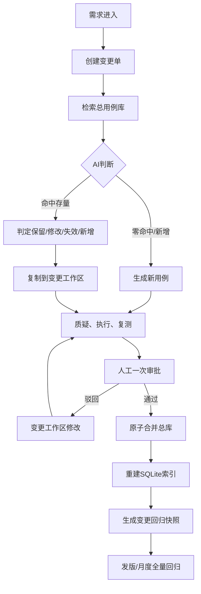

# AI 测试总用例库一期实施方案

**版本：** V1.0  
**定位：** V2.5 目标架构的最小可用落地版本  
**适用范围：** 首个试点业务线和模块

---

## 1. 实施目标

一期不追求一次完成完整平台，而是先验证总用例库最核心的价值：

1. 单条用例可以统一入库、检索和追溯；
2. 新功能可以新增用例并进入总库；
3. 优化功能可以复用、修改和替代历史用例；
4. AI 只能在变更工作区修改，不能直接改总库；
5. 每个变更单只进行一次人工审批；
6. 审批通过后生成稳定的回归用例集。

一期暂不建设完整的发布平台和复杂治理机制。

## 2. 一期范围

### 2.1 纳入范围

- 单条用例管理；
- 全局唯一 `case_id`；
- 用例版本管理；
- 新增、修改、失效、替代；
- 业务线、租户、客户版本适用范围；
- Git 正本；
- SQLite 检索索引；
- 变更工作区；
- 一次人工审批；
- 变更回归和全量回归快照；
- 与现有 Agent 的检索、生成、质疑、执行、反馈闭环接入。

### 2.2 暂不纳入

- `STAGED` 待发布状态；
- `VOID` 作废状态；
- `ARCHIVED` 自动归档；
- 上线事件自动回调；
- `review_flag` 待复审治理；
- 治理型变更单；
- 复杂乐观锁和并行冲突自动处理；
- PostgreSQL、向量数据库和 Web 审批平台；
- MR 代码路径自动影响分析。

这些能力保留在二期，不影响一期主流程。

## 3. 一期简化原则

### 3.1 用例状态最小化

```text
DRAFT       仅存在于变更工作区
ACTIVE      当前有效，参与回归
RETIRED     已失效，保留历史，不参与回归
```

### 3.2 变更单状态最小化

```text
DRAFT       编辑中
REVIEW      待人工审批
MERGED      已合并总库
REJECTED    已驳回
```

“变更中”不作为主库用例状态；“待发布”也不作为一期独立状态。

### 3.3 生效方式

一期以“人工审批通过 + Git 合并提交”作为生效点。Git commit 是唯一正本变更边界，SQLite 索引由 commit 重新构建。

## 4. 一期总体流程



## 5. 两类业务流程

### 5.1 新功能需求

```text
需求答疑完成
→ 检索总库并保留检索记录
→ 无匹配或确认无复用用例
→ AI 生成候选用例
→ 独立质疑
→ AI 执行、复测、反馈闭环
→ 形成审批包
→ 一次人工审批
→ 分配正式 case_id
→ ACTIVE 入库
→ 生成变更回归集和全量回归快照
```

### 5.2 优化功能需求

```text
需求答疑完成
→ 检索历史用例
→ AI 逐条标记：保留 / 修改 / 失效 / 新增
→ 修改项复制到变更工作区
→ 生成新版本和替代关系
→ 独立质疑
→ AI 执行、复测、反馈闭环
→ 形成审批包
→ 一次人工审批
→ 原子合并：新版本 ACTIVE，旧版本 RETIRED 或继续 ACTIVE
→ 生成变更回归集和全量回归快照
```

### 5.3 规则

- 审批前不修改主库；
- AI 不直接删除用例；
- 旧用例失效必须记录原因；
- 新旧用例必须建立 `REPLACES` 关系；
- 审批不允许部分合并；
- 执行结果不覆盖用例定义；
- 用例正文修改必须保留旧版本。

## 6. 一期仓库结构

```text
total-case-library/
├── cases/              # 当前有效和历史用例正本
│   └── <业务线>/<域>/<模块>/shard-0001.yaml
├── changes/             # 变更工作区和已合并变更记录
│   ├── active/
│   └── merged/
├── relations/           # 需求、版本和替代关系
├── snapshots/           # 变更回归、全量回归快照
├── approvals/           # 人工审批记录
├── schemas/             # Schema 和机检脚本
├── index.sqlite         # 派生检索索引
└── README.md
```

Git 是唯一正本；`index.sqlite` 删除后可以从 Git 全量重建。

## 7. 一期核心数据模型

### 7.1 用例字段

```yaml
case_id: TC-REFUND-0001
case_version: 1
status: ACTIVE
title: 全额退款成功
business_lines: [finance]
tenant_scope: ALL
customer_scope: STANDARD
product_version_from: v1.0
product_version_to: null
priority: P0
case_type: UI
automation_mode: ai
preconditions: []
steps: []
expected_results: []
basis_refs: []
requirement_ids: []
legacy_ids: []
```

### 7.2 变更单字段

```yaml
change_set_id: CHG-20261120-001
iteration_id: ITER-20261120
status: REVIEW
change_type: feature | optimization
base_commit: <git-commit>
add_cases: []
modify_cases: []
retire_cases: []
impact_cases: []
approval_record: null
```

### 7.3 关系类型

```text
REPLACES       新用例替代旧用例
DERIVED_FROM   新版本来源于旧用例
IMPACTS        需求影响但未修改的用例
```

## 8. 检索机制

一期只做两种检索：

1. 结构化检索：业务线、系统、模块、功能点、租户、客户版本、状态；
2. 文本检索：标题、步骤、预期、判断依据中的关键词和 BM25。

语义向量可以作为可选增强，但一期不把向量阈值作为失效或替代的自动判定条件。AI 必须输出：

```text
候选用例 ID
命中依据
相似/影响原因
建议动作
置信度
```

最终的修改、失效和替代仍进入一次人工审批。

## 9. 一期 Agent 接入

### 9.1 新增三个能力

| 能力 | 责任 |
|---|---|
| `case-library-search` | 检索、过滤和输出候选用例 |
| `case-impact-analysis` | 判断新增、修改、保留、失效和影响范围 |
| `case-library-merge` | 校验审批、合并总库、分配编号、重建索引、生成快照 |

### 9.2 现有技能接入点

| 现有技能 | 一期改造 |
|---|---|
| `usecase-orchestrator` | 新需求先创建变更单并调用检索 |
| `requirement-qa-loop` | 补充业务线、租户、客户版本和产品版本问题 |
| `usecase-generator` | 只写变更工作区，不直接写总库 |
| `usecase-challenger` | 检查复用关系、修改范围和替代关系 |
| `usecase-executor` | 执行变更回归集和全量快照，结果写执行账本 |
| `usecase-feedback-loop` | 将 SYS/DEF/IMP/CHG 转换为变更单条目 |

## 10. 回归策略

### 10.1 变更回归

每个变更单合并后执行：

- 新增用例；
- 修改后的新版本；
- 受影响但未修改的用例；
- 同机制兄弟场景；
- 相关 P0 核心链路。

### 10.2 全量回归

按发版或月度触发，执行：

```text
status = ACTIVE
AND 适用目标业务线
AND 适用目标租户
AND 适用目标客户版本
AND 产品版本处于有效区间
```

P0/P1/P2/P3 均纳入，优先级只决定执行顺序。`manual_only` 必须人工执行或明确记录 `NOT_EXECUTED`，不得静默删除。

## 11. 一次审批包

审批包必须包含：

1. 需求和答疑结论；
2. 检索候选及命中依据；
3. 新增用例全文；
4. 修改前后字段级 diff；
5. 失效原因和替代关系；
6. 业务线、租户、客户版本和产品版本；
7. 质疑证书、执行结果和复测结果；
8. 预计新增、修改、失效和全量回归条数。

审批只有两个结果：

```text
通过：允许合并
驳回：填写原因，回变更工作区修改
```

## 12. 合并门禁

合并前必须全部通过：

1. `case_id` 无冲突；
2. 用例字段完整；
3. 步骤和预期可执行、可判定；
4. 适用范围格式正确；
5. 失效用例有原因；
6. 替代关系无孤儿；
7. 质疑证书存在且有效；
8. 执行和复测结果已归档；
9. 人工审批记录存在；
10. Git 合并后 SQLite 索引可成功重建；
11. 合并前后用例数量和状态对账一致。

## 13. 技术实现方式

一期采用“Git + SQLite + CLI”，不建设独立服务。

### 13.1 合并流程

```text
1. 读取变更工作区
2. 执行 Schema、编号、关系和审批门禁
3. 生成完整目标状态
4. 写入 Git 工作树
5. 创建一个 Git commit
6. 从该 commit 重建 SQLite 索引
7. 生成回归快照
8. 记录合并日志
```

Git commit 是用例正式生效点。若索引重建失败：

- 不修改 Git 正本；
- 保留上一版可用索引；
- 标记索引构建失败；
- 修复后重新从 Git commit 构建。

## 14. 存量迁移

按业务线分批，不一次迁移全公司：

```text
盘点文件
→ 解析单条用例
→ 保留原编号和原需求
→ 判重
→ 补业务线/租户/客户/版本
→ 抽样复核
→ 入库
→ 生成首个全量快照
→ 新旧数量对账
→ 业务线切换，旧库只读
```

无法确定适用范围的用例不得默认 `ALL`，先进入待补清单。

## 15. 分阶段实施计划

| 阶段 | 周期 | 工作内容 | 交付物 |
|---|---:|---|---|
| P0 口径设计 | 1周 | 确定 Schema、编号、状态、关系、回归定义 | Schema、样例、机检规则 |
| P1 最小闭环 | 2周 | Git、SQLite、CLI、变更工作区、审批包、合并脚本 | 新功能和优化功能各跑通 1 次 |
| P2 Agent 接入 | 2周 | 接入检索、影响分析和合并能力 | Agent 可检索、生成审批包和回归快照 |
| P3 试点迁移 | 2–4周 | 迁移一个业务线或模块 | 试点业务线切换到总库 |
| P4 评估推广 | 1周 | 复盘成本、质量和收益 | 是否扩展其他业务线的决策 |

## 16. 试点选择建议

优先选择：

- 一个业务线；
- 一个中等复杂度模块；
- 约 300–1000 条历史用例；
- 同时存在新功能和优化需求；
- 有一定 UI/API 自动化基础；
- 能获得业务线、租户和版本信息。

不建议从全公司所有业务线同时启动。

## 17. 一期验收标准

| 指标 | 目标 |
|---|---:|
| 新功能入库流程成功率 | 100% |
| 优化功能入库流程成功率 | 100% |
| `case_id` 冲突数 | 0 |
| 审批前主库被直接修改次数 | 0 |
| RETIRED 用例物理删除数 | 0 |
| 替代关系完整率 | 100% |
| 变更回归快照生成成功率 | 100% |
| 全量快照与 ACTIVE 适用用例对账一致率 | 100% |
| Git 与 SQLite 索引对账一致率 | 100% |
| 执行结果可追溯率 | 100% |

## 18. 二期建设方向

一期稳定后，再按实际痛点增加：

- `STAGED` 与上线事件；
- 发布前回归和生产基线回归分层；
- `review_flag` 待复审治理；
- `VOID` 和治理型变更单；
- 并行变更乐观锁；
- PostgreSQL/pgvector；
- Web 审批和看板；
- MR 代码路径影响分析；
- 自动归档和健康度巡检。

## 19. 实施结论

一期只解决三个问题：

```text
历史用例能不能找到？
变更后的用例能不能安全入库？
回归时能不能拿到正确的有效用例集？
```

只要这三个问题在一个试点业务线中跑通，再逐步增加 V2.5 的发布治理和自动化能力，方案就具备可推行性。不要先建设完整平台再迁移数据，应采用：

```text
金标样例
→ 最小闭环
→ 真实需求试跑
→ 修正规则
→ Agent 接入
→ 分业务线迁移
→ 服务化
```
