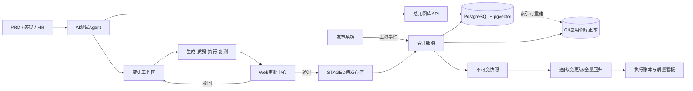
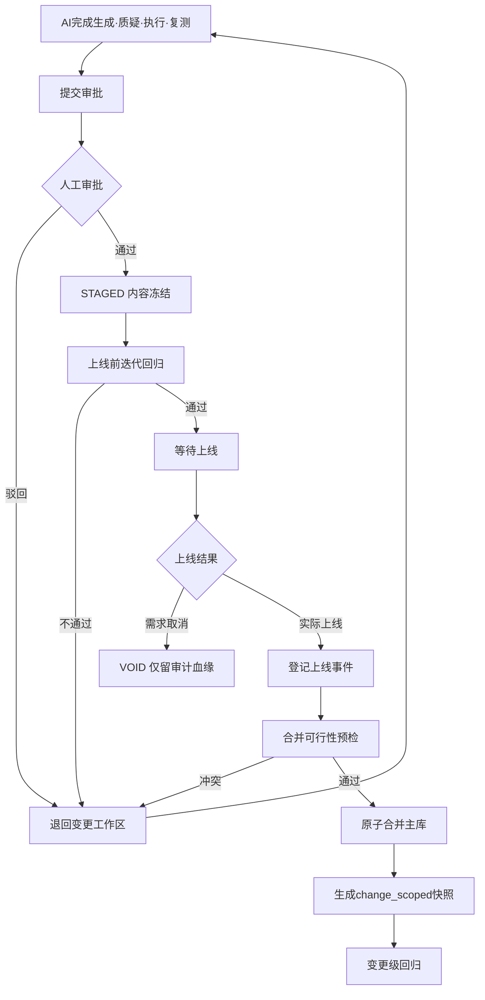
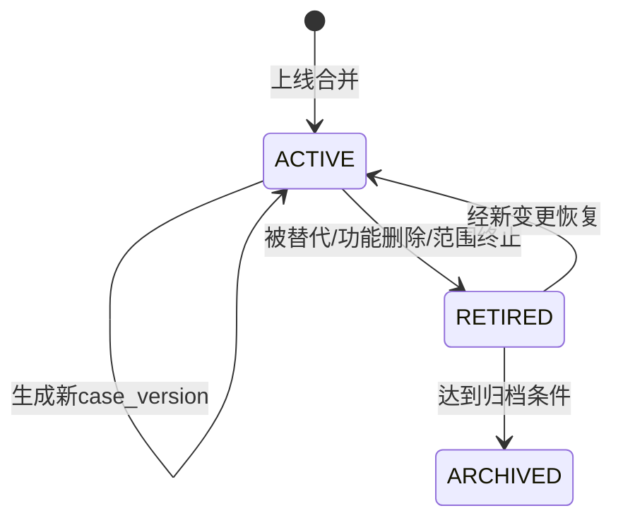
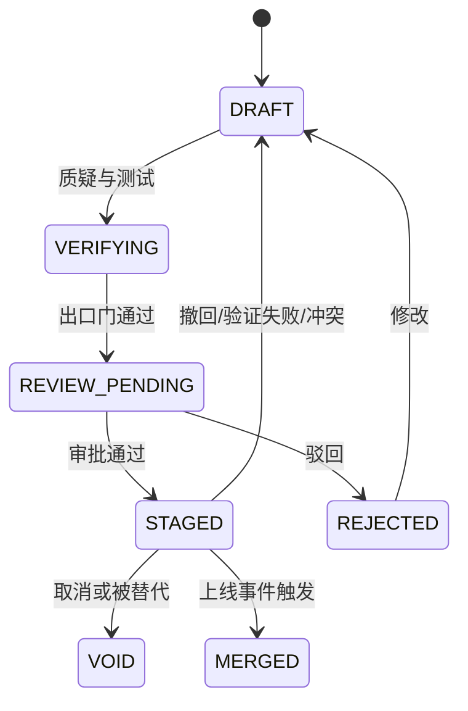
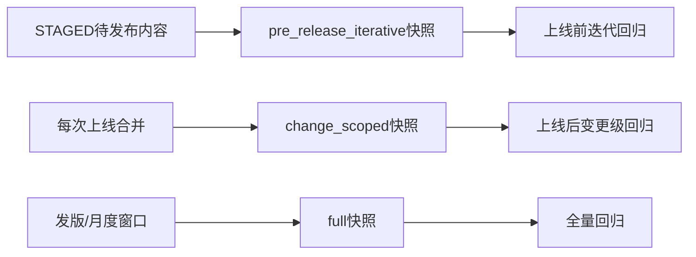

# AI 测试总用例库二期建设方案

**版本：** V1.0  
**定位：** 在一期最小闭环基础上，建设公司级发布治理与平台化能力  
**适用范围：** 已完成一期验收、准备向多个业务线推广的总用例库

---

## 1. 二期定位

一期解决三个基础问题：

```text
历史用例能否找到？
变更后的用例能否安全入库？
回归时能否获得正确的有效用例集？
```

二期进一步解决五个规模化问题：

1. 审批通过但未上线的用例，如何避免提前污染主库；
2. 多个需求并行修改同一用例时，如何发现和处理冲突；
3. 多业务线、多租户和多客户版本下，如何准确生成回归范围；
4. 如何将本地 CLI 升级为多人、多机可用的平台服务；
5. 如何持续发现过时、重复、长期未执行和质量较差的用例。

二期的核心定位是：

> 将一期的“可用用例库”升级为“与发布过程联动、可多人协作、可持续治理的公司级测试资产平台”。

## 2. 二期建设目标

- **发布一致性：** 审批通过后先进入待发布区，实际上线后才进入主库；
- **并发安全：** 支持多个需求并行修改用例，并在合并前识别冲突；
- **智能检索：** 增加语义向量和 MR 代码路径影响分析；
- **平台服务化：** 建设统一 API、Web 审批页面和管理看板；
- **三档回归：** 明确上线前迭代回归、上线后变更级回归、发版/月度全量回归；
- **持续治理：** 支持待复审、作废、治理变更、归档和健康度巡检；
- **规模推广：** 按业务线迁移存量用例并完成公司级切换。

## 3. 二期启动条件

只有一期满足以下条件后，才进入二期：

| 条件 | 准入要求 |
|---|---:|
| 新功能入库流程 | 至少成功运行 2 次 |
| 优化功能入库流程 | 至少成功运行 2 次 |
| `case_id` 冲突 | 0 |
| 审批前直接修改主库 | 0 次 |
| Git 与 SQLite 索引一致率 | 100% |
| 回归快照生成成功率 | 100% |
| 试点业务线适用范围完整率 | 100% |
| 执行结果可追溯率 | 100% |

若一期仍存在流程频繁绕行、字段持续变化或索引无法稳定重建，不应提前建设二期平台。

## 4. 二期建设范围

### 4.1 纳入范围

1. `STAGED` 待发布状态；
2. 发布/上线事件驱动的正式合并；
3. `VOID` 作废状态和需求取消处理；
4. `review_flag` 待复审治理；
5. 治理型变更单；
6. `case_version` 乐观锁和并发冲突处理；
7. 三档回归与三类不可变快照；
8. PostgreSQL + pgvector 检索服务；
9. FastAPI 服务接口；
10. Web 审批、查询和管理看板；
11. MR 代码路径影响分析；
12. 自动归档、健康度巡检和公司级存量迁移。

### 4.2 不纳入范围

- AI 自动审批；
- AI 自动将用例置为失效而不经人工确认；
- 自动修改生产系统或发布配置；
- 未经业务线确认直接把未知适用范围标记为 `ALL`；
- 用总用例库替代需求管理、缺陷管理和发布平台。

## 5. 二期总体架构



### 5.1 各组件职责

| 组件 | 职责 |
|---|---|
| Git 总库 | 用例定义、版本、关系和审批证据的唯一正本 |
| PostgreSQL | 结构化查询、权限、状态和统计索引 |
| pgvector | 语义相似用例召回 |
| FastAPI | 向 Agent、审批页和发布系统提供统一接口 |
| Web 审批中心 | 展示新增、修改、失效、适用范围和执行证据 |
| 发布事件适配器 | 接收发布系统回调或人工登记的上线事实 |
| 合并服务 | 校验审批与上线事件，执行编号分配和原子生效 |
| 回归规划器 | 生成三类快照和回归集 |
| 健康度服务 | 发现重复、过时、长期未执行和适用范围缺失用例 |

## 6. 发布生效流程

一期中“审批通过”即合并。二期调整为“审批通过不等于正式生效”：



### 6.1 `STAGED` 待发布

- 人工审批通过后进入 `STAGED`；
- 内容冻结并绑定审批 hash；
- 不进入主库 ACTIVE 基线；
- 只用于上线前预发验证；
- 审批后内容变化必须退回并重新审批。

### 6.2 上线事件

上线事件至少包含：

```text
release_event_id
change_set_id
target_release_version
environment
released_at
release_status
source
```

事件来源优先级：

1. 发布平台自动回调；
2. GitLab/GitHub 发布流水线回调；
3. 测试负责人手工登记兜底。

### 6.3 `VOID` 作废

以下情况转为 `VOID`：

- 需求取消，不再上线；
- 待发布内容被另一变更单整体替代；
- 变更单长期滞留，经负责人确认作废。

`VOID` 只保留审批、执行和问题记录，不进入主库，也不分配正式 `case_id`。

## 7. 状态模型

### 7.1 主库用例状态



### 7.2 变更单状态



### 7.3 待复审标记

`review_flag=待复审` 不新增用例状态。以下情况置位：

- 执行失败并判定用例预期可能过时；
- 依赖的接口、标准或数据准备发生变化；
- 健康度巡检发现长期未验证或内容异常。

带待复审标记的用例仍保持 ACTIVE，但下一次相关变更必须明确处理为：

```text
MODIFY       修改用例
UNAFFECTED   确认无需修改并清除标记
RETIRE       失效并清除标记
```

长期未处理的待复审用例进入治理清理任务。

## 8. 并行变更与冲突治理

### 8.1 乐观锁规则

每个变更单记录涉及用例的 `case_id + base_case_version`。合并时检查：

```text
当前 case_version = base_case_version → 可继续合并
当前 case_version > base_case_version → 存在并发冲突
```

冲突后必须：

1. 重新读取当前主库版本；
2. 重新进行影响分析；
3. 重新生成字段级 diff；
4. 内容发生变化时重新质疑、执行和审批。

治理元数据写入不递增 `case_version`，不应误触发业务内容冲突。

### 8.2 合并可行性预检

上线前对同一发布批次所有 `STAGED` 变更执行预检：

- 是否修改同一 `case_id`；
- 是否存在整体覆盖；
- 是否存在部分交叠冲突；
- 临时编号与正式编号映射是否完整；
- 失效与替代关系是否冲突；
- 审批 hash 是否仍与冻结内容一致。

## 9. 三档回归与快照



| 类型 | 时点 | 范围 | 目的 |
|---|---|---|---|
| 迭代回归 | 上线前预发环境 | 新增、修改、受影响及核心链路 | 验证待发布内容 |
| 变更级回归 | 每次上线合并后 | 本次变更与影响范围 | 验证新基线集成正确 |
| 全量回归 | 发版或月度 | 全部适用且 ACTIVE 用例 | 周期性兜底保障 |

### 9.1 全量回归筛选

```text
status = ACTIVE
AND business_line 匹配
AND tenant_scope 匹配
AND customer_scope 匹配
AND product_version 在有效区间
```

全量回归 P0/P1/P2/P3 均纳入。优先级只决定执行顺序，不改变“全量”的定义。

## 10. 智能检索升级

### 10.1 三通道检索

1. **结构化检索：** 业务线、模块、功能点、租户、客户和版本；
2. **文本检索：** 关键词、同义词、BM25；
3. **代码影响检索：** MR 文件、接口、路由、服务和数据库表映射。

语义向量用于召回相似用例，不直接决定修改或失效。

### 10.2 MR 影响映射

逐步建立：

```text
代码仓库/服务
→ 文件路径
→ 接口/页面路由
→ 业务模块
→ case_id
```

当 MR 发生变化时，系统自动召回直接关联和下游依赖用例，交由 `case-impact-analyzer` 判断。

### 10.3 评估指标

- 候选召回率；
- 候选准确率；
- 人工补充用例比例；
- AI 错误失效建议率；
- MR 影响用例漏召回率。

## 11. 治理型变更

部分变更不来自业务需求，也没有上线事件，例如：

- 补齐租户和客户适用范围；
- 修正编号、标签或归属模块；
- 清理待复审标记；
- 修正历史迁移错误。

这些内容使用 `governance` 变更单：

```text
创建治理单
→ 明确目标用例与依据
→ Schema和影响检查
→ 人工审批
→ 治理合并
→ 重建索引
→ 写审计日志
```

治理型变更不要求上线事件，但仍禁止绕过审批直接修改主库。

## 12. 平台服务化

### 12.1 核心接口

```text
POST /cases/search
POST /impact-analysis
POST /change-sets
GET  /change-sets/{id}
POST /change-sets/{id}/submit-review
POST /change-sets/{id}/approve
POST /change-sets/{id}/reject
POST /change-sets/{id}/withdraw
POST /change-sets/{id}/void
POST /release-events
POST /change-sets/{id}/merge
POST /change-sets/{id}/apply-governance
POST /regression-snapshots
GET  /regression-snapshots/{id}/cases
POST /executions
POST /executions/{id}/results
```

### 12.2 Web 页面

| 页面 | 核心功能 |
|---|---|
| 用例查询 | 检索、筛选、版本和血缘查看 |
| 变更中心 | 查看 DRAFT/REVIEW/STAGED/MERGED/VOID |
| 审批中心 | 展示新增、diff、失效、适用范围和执行证据 |
| 回归中心 | 创建快照、查看执行进度和阻塞项 |
| 治理中心 | 待复审、重复、长期未执行和范围缺失清单 |
| 质量看板 | 用例规模、覆盖率、自动化率、健康度和趋势 |

### 12.3 权限模型

| 角色 | 权限 |
|---|---|
| AI Agent | 读主库；写变更区、审批包和执行账本 |
| 业务测试 | 补充范围、复核候选、查看执行结果 |
| 测试负责人 | 审批、撤回、确认 VOID 和归档 |
| 发布系统 | 登记上线事件 |
| 库管理服务 | 分配编号、合并、重建索引和生成快照 |
| 平台管理员 | 权限、Schema、备份和恢复 |

AI Agent 不拥有直接修改主库 main 分支的权限。

## 13. 持续健康度治理

### 13.1 巡检内容

- 疑似重复用例；
- 长期未执行用例；
- 长期 BLOCKED/NOT_EXECUTED 用例；
- 失效但无替代关系的用例；
- 适用范围缺失或冲突；
- 判断依据失效；
- 自动化脚本长期失败；
- 待复审标记超期；
- ACTIVE 用例无任何需求或模块归属。

### 13.2 健康度指标

| 指标 | 目标 |
|---|---:|
| 适用范围完整率 | 100% |
| 失效原因完整率 | 100% |
| 替代关系完整率 | 100% |
| 执行结果可追溯率 | 100% |
| 长期待复审超期数 | 0 |
| Git 与数据库一致率 | 100% |
| 全量快照纳入率 | 100% |
| 重复用例比例 | 持续下降 |
| 自动化可执行比例 | 持续提升 |

## 14. 公司级存量迁移

二期按业务线滚动迁移，不做一次性全公司切换：


### 14.1 单业务线切换门槛

- 四轴适用范围完整率 100%；
- `case_id` 无冲突；
- 重复用例已确认处置；
- ACTIVE/RETIRED 状态明确；
- 核心链路抽检通过；
- 首个全量快照生成并对账；
- Agent 检索与回归执行验证通过；
- 旧库切换为只读。

## 15. 二期实施阶段


| 阶段 | 建设内容 | 主要交付物 | 验收重点 |
|---|---|---|---|
| 1. 发布治理 | STAGED、上线事件、VOID、乐观锁、三档快照 | 发布适配器、合并预检、状态机 | 未上线内容不污染主库 |
| 2. 平台服务化 | PostgreSQL、FastAPI、审批页、权限 | API 服务、Web 平台、审计日志 | 多人多机可稳定使用 |
| 3. 智能检索 | pgvector、同义词、MR 路径映射 | 三通道检索、评估集 | 召回率达到试点基线 |
| 4. 治理与迁移 | review_flag、治理单、健康巡检、业务线迁移 | 治理中心、迁移工具 | 逐业务线完成切换 |
| 5. 稳定运营 | 性能、备份、容灾、指标优化 | 运行手册、SLA、看板 | 平台进入常态运营 |

## 16. 团队与职责

| 角色 | 主要责任 |
|---|---|
| 测试负责人 | 规则定谳、审批、业务线切换验收 |
| 测试平台开发 | API、数据库、审批平台、合并与快照服务 |
| AI Agent 负责人 | 技能接入、提示词、门禁和执行链路 |
| 业务测试 | 金标样本、适用范围、迁移抽检 |
| 发布平台负责人 | 上线事件和版本映射 |
| 开发团队 | MR 规范、接口/路由/服务映射 |
| 运维/DBA | 部署、监控、备份和恢复 |

### 建议最低投入

- 测试平台开发：1–2 人；
- AI Agent 开发：1 人；
- 测试架构/负责人：1 人；
- 试点业务测试：1–2 人；
- 发布平台支持：按需投入。

## 17. 二期验收指标

| 指标 | 目标 |
|---|---:|
| 未上线变更污染主库 | 0 次 |
| 审批后内容被替换未重审 | 0 次 |
| 上线事件与变更单关联率 | 100% |
| 临时号到正式号映射完整率 | 100% |
| 并发冲突识别率 | 100% |
| 非法 VOID 状态迁移 | 0 次 |
| 三类快照生成正确率 | 100% |
| 全量快照纳入率 | 100% |
| Git 与 PostgreSQL 索引一致率 | 100% |
| 待复审处置闭环率 | 100% |
| 已迁移业务线旧库写入次数 | 0 次 |
| API 可用性 | ≥99.9% |
| 审批与执行证据可追溯率 | 100% |

检索召回率和自动化率应先建立真实评估集，再确定数值目标，避免使用没有数据依据的阈值。

## 18. 主要风险与控制

| 风险 | 控制措施 |
|---|---|
| 上线事件不可靠 | 自动回调为主、人工登记兜底；超期 STAGED 预警 |
| 流程过重影响迭代效率 | 分阶段启用治理能力，低风险治理变更走专用流程 |
| 并行冲突导致重复审批 | 审批前执行合并预检，只在内容变化时重审 |
| 语义检索误召回 | 向量只用于候选召回，不直接决定失效 |
| 多租户/客户误执行 | 四轴适用范围强校验，生成快照时二次验证 |
| 数据库与 Git 不一致 | Git 为正本，索引可重建；每次合并进行 hash 对账 |
| 存量迁移周期过长 | 按业务线切换，核心模块优先，不阻塞新需求使用 |
| Web 平台过早复杂化 | 先完成发布治理和 API，再建设页面和看板 |
| 全量回归成本过高 | 迭代/变更级回归承担日常反馈，全量按发版/月度执行 |

## 19. 管理层需拍板事项

1. 二期建设预算和人员投入；
2. 发布平台接入方式和上线事件责任人；
3. 测试负责人审批权限及代理规则；
4. 首批推广的业务线顺序；
5. PostgreSQL/pgvector 的部署环境；
6. 全量回归触发周期和最大执行窗口；
7. 用例、快照和执行证据的保留年限；
8. 平台可用性与故障恢复目标；
9. MR 路径映射所需的研发规范；
10. 公司级切换完成时间目标。

## 20. 二期建设结论

二期不是重新建设一套用例库，而是在一期已验证闭环上增加四层能力：

```text
发布治理层：STAGED + 上线事件 + VOID + 并发冲突
平台服务层：PostgreSQL + FastAPI + Web审批 + 权限审计
智能分析层：语义检索 + MR代码影响分析
持续治理层：待复审 + 健康巡检 + 分业务线迁移
```

建设顺序应当是：

```text
先保证上线生效准确
→ 再实现多人协作平台
→ 再增强智能检索
→ 最后扩大迁移和持续治理
```

二期完成后，总用例库将从试点工具升级为与 AI 测试 Agent、发布系统和测试管理流程联动的公司级测试资产平台。
