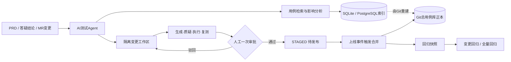
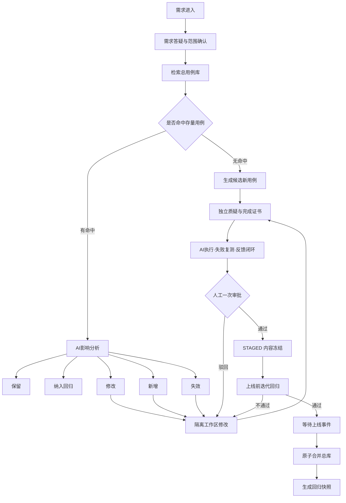
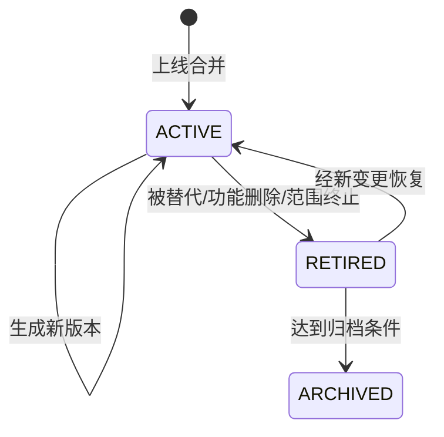
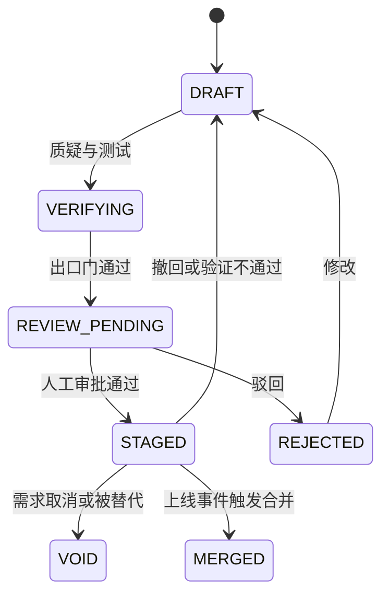
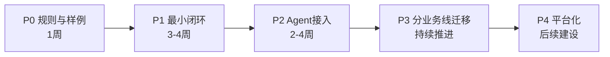

# AI 测试总用例库建设方案

**汇报精简版｜基于 V2.5**  
**日期：** 2026-11-20  
**适用范围：** 公司级多业务线、多租户、多客户版本的测试用例治理与 AI 回归执行

---

## 一、建设背景

当前 AI 测试 Agent 已经覆盖：

> 需求答疑 → 用例生成 → 独立质疑 → AI 执行 → 问题反馈 → AI 复测 → 人工复核

但用例资产仍按需求分散保存，缺少公司级统一用例正本，主要存在四类问题：

1. 历史用例难以检索和复用，相似需求可能重复编写；
2. 功能优化后，旧用例修改、失效和替代关系不清晰；
3. 回归范围依赖人工判断，容易漏测或重复执行；
4. 多业务线、租户和客户版本的适用范围缺少统一管理。

因此，需要建设一套可被 AI Agent 调用的公司级总用例库，让用例从“需求交付物”转变为“可持续复用的测试资产”。

## 二、建设目标

- **统一管理：** 每条用例拥有全局唯一 `case_id`，按单条用例管理；
- **智能复用：** 新需求进入后，Agent 自动检索历史用例并分析影响；
- **安全变更：** AI 只能修改隔离工作区，审批前不影响主库；
- **版本追溯：** 用例新增、修改、失效、替代均保留完整历史；
- **范围准确：** 支持业务线、租户、客户和产品版本四维适用范围；
- **自动回归：** 自动生成迭代回归、变更级回归和全量回归集；
- **审计可查：** 打通需求、用例、执行、缺陷、审批和版本记录。

## 三、总体方案

总用例库采用“Git 正本 + 结构化索引 + AI Agent”的架构：



### 核心定位

| 组成 | 定位 |
|---|---|
| Git 总用例库 | 用例定义、版本和审批记录的唯一正本 |
| SQLite/PostgreSQL | Agent 查询使用的派生索引，可从 Git 重建 |
| 变更工作区 | AI 新增和修改用例的隔离区域 |
| 执行账本 | 保存执行结果、证据、缺陷和复测记录 |
| Markdown/XMind/XLSX | 用例阅读和交付视图，不作为正本 |

## 四、核心数据设计

### 1. 用例基本信息

```text
case_id                 全局唯一编号
case_version            用例版本
title                   用例标题
preconditions           前置条件
steps                   执行步骤
expected_results        预期结果
basis_refs              需求、答疑、标准或代码依据
priority                P0/P1/P2/P3
case_type               UI/API/E2E/性能/安全/人工
automation_mode         auto/ai/manual_only
status                  ACTIVE/RETIRED/ARCHIVED
```

### 2. 适用范围

```text
business_lines          适用业务线
tenant_scope            全部、租户类型或指定租户
customer_scope          标准版、指定客户或排除客户
product_version_from    起始版本
product_version_to      终止版本
```

### 3. 用例关系

- `REPLACES`：新用例替代旧用例；
- `DERIVED_FROM`：新版本来源于历史用例；
- `COVERS_WITH`：多条用例共同覆盖一个风险；
- `DEPENDS_ON`：用例间存在执行依赖。

旧用例不物理删除，失效后转为 `RETIRED`，保留原因和替代指针。

## 五、需求到用例入库流程



### 新功能需求

检索无匹配时，AI 生成新用例，经质疑、执行和审批后，分配正式编号并进入主库。

### 优化功能需求

Agent 检索历史用例，逐条判断保留、修改、回归、新增或失效。修改发生在隔离工作区，审批通过且需求上线后，新版本生效、旧版本失效并建立替代关系。

## 六、用例状态和变更控制

### 主库用例状态



### 变更单状态



核心规则：

- 审批前主库不变；
- 审批通过只冻结内容，不立即进入主库；
- 需求真正上线后才触发总库合并；
- 新版本生效、旧版本失效和替代关系建立在同一合并事务内完成；
- 审批后的内容发生变化必须重新审批。

## 七、回归策略

| 回归类型 | 执行时点 | 执行范围 | 主要目的 |
|---|---|---|---|
| 迭代回归 | 上线前、预发环境 | 本迭代新增、修改、受影响用例及核心链路 | 验证待发布内容是否正确 |
| 变更级回归 | 每次上线合并后 | 本次变更及受影响用例 | 快速验证新基线未被破坏 |
| 全量回归 | 发版或月度 | 目标范围内全部适用且有效用例 | 版本发布前或周期性兜底 |

全量用例筛选规则：

```text
status = ACTIVE
AND 适用目标业务线
AND 适用目标租户
AND 适用目标客户或标准版
AND 产品版本处于有效区间
```

P0/P1/P2/P3 均进入全量集，优先级只决定执行顺序。无法自动执行的用例必须记录 `NOT_EXECUTED` 或 `BLOCKED`，不得静默剔除。

## 八、与现有 AI Agent 的接入

### 新增能力

| 能力 | 作用 |
|---|---|
| `case-library-search` | 检索历史用例和适用范围过滤 |
| `case-impact-analyzer` | 判断保留、修改、新增、失效和回归范围 |
| `case-change-workspace` | 建立变更单和隔离工作区 |
| `case-library-review` | 生成一次人工审批包 |
| `case-library-merge` | 分配编号、合并总库、重建索引和生成快照 |
| `regression-planner` | 生成迭代、变更级和全量回归集 |

### 现有流程接入点

```text
orchestrator       创建变更单并调度总库流程
qa-loop            确认业务线、租户、客户和版本范围
generator          读取历史候选，只写隔离工作区
challenger         质疑覆盖、血缘和适用范围
executor           按回归快照执行并写执行账本
feedback-loop      将执行发现转为修改、失效或新增提案
```

## 九、分期建设路线



| 阶段 | 建设内容 | 验收结果 |
|---|---|---|
| P0 规则与样例 | Schema、编号、状态、适用范围；建立金标样本 | 单条用例可入库、检索和追溯 |
| P1 最小闭环 | Git、SQLite、CLI、变更区、审批、上线合并、快照 | 新功能和优化功能各跑通一次 |
| P2 Agent 接入 | 接入检索、影响分析、审批、合并和回归规划 | Agent 可自主调用总库完成闭环 |
| P3 存量迁移 | 按业务线解析、判重、补范围并切换 | 已切换业务线只写总库 |
| P4 平台化 | PostgreSQL/pgvector、FastAPI、审批页、看板 | 支持多人多机和规模化运营 |

### 推行建议

先选择一个业务线、一个中等复杂模块和 300–1000 条历史用例进行试点，同时选择一项新功能和一项优化需求验证两条主流程。试点通过后再分业务线迁移，不建议一次性迁移全公司。

## 十、预期收益

### 质量收益

- 历史用例召回，减少重复编写和覆盖遗漏；
- 新旧用例替代关系明确，避免错误用例继续执行；
- 回归范围由规则和快照生成，降低人工漏选风险；
- 用例与执行结果、缺陷、需求关联，可快速定位质量问题。

### 效率收益

- AI 自动完成检索、影响分析、生成、质疑和回归规划；
- 人工只需要完成一次关键审批；
- 用例可跨需求、跨版本复用；
- 支持按发版和月度自动组装全量回归集。

### 管理收益

- 建立公司统一测试资产正本；
- 支持多业务线、租户和客户版本隔离；
- 所有变更有版本、有审批、有证据；
- 可形成用例健康度、自动化率、回归覆盖率等管理指标。

## 十一、主要风险与控制

| 风险 | 控制措施 |
|---|---|
| AI 漏召回历史用例 | 结构化检索与文本检索取并集，检索证据进入审批包 |
| AI 错误失效用例 | 审批前主库不变，失效必须有依据和替代关系 |
| 多需求同时修改同一用例 | 使用 `case_version` 乐观锁，冲突后重新分析和审批 |
| 未上线需求污染主库 | 审批后只进入 STAGED，上线事件才触发合并 |
| 租户或客户范围错误 | 适用范围结构化，快照生成时再次校验 |
| Git 与索引不一致 | Git 是唯一正本，索引可全量重建并进行数量/hash 对账 |
| 全量回归成本过高 | 日常使用迭代和变更级回归，全量按发版或月度执行 |

## 十二、需要管理层拍板的事项

1. 一期试点业务线和模块；
2. 用例正式编号规则；
3. 业务线、租户、客户和版本主数据来源；
4. 入库审批责任人和代理规则；
5. 发版/月度全量回归周期；
6. 上线事件由发布系统回调还是人工登记；
7. 执行证据、快照和失效用例的保留年限；
8. 项目人员投入和试点时间窗口。

## 十三、结论

总用例库不是简单的历史用例文件夹，而是一套公司级测试资产治理体系：

```text
以单条用例为管理对象
+ 以 Git 为审计正本
+ 以结构化索引供 Agent 检索
+ 以变更单和一次审批控制变更
+ 以上线事件决定正式生效
+ 以不可变快照确定回归边界
```

建议采取“规则样例 → 最小闭环 → Agent 接入 → 分业务线迁移 → 平台化”的渐进路线，先通过试点验证价值，再逐步扩大建设范围。
