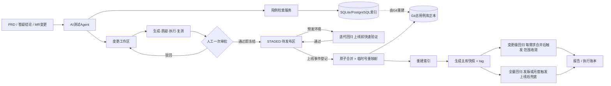
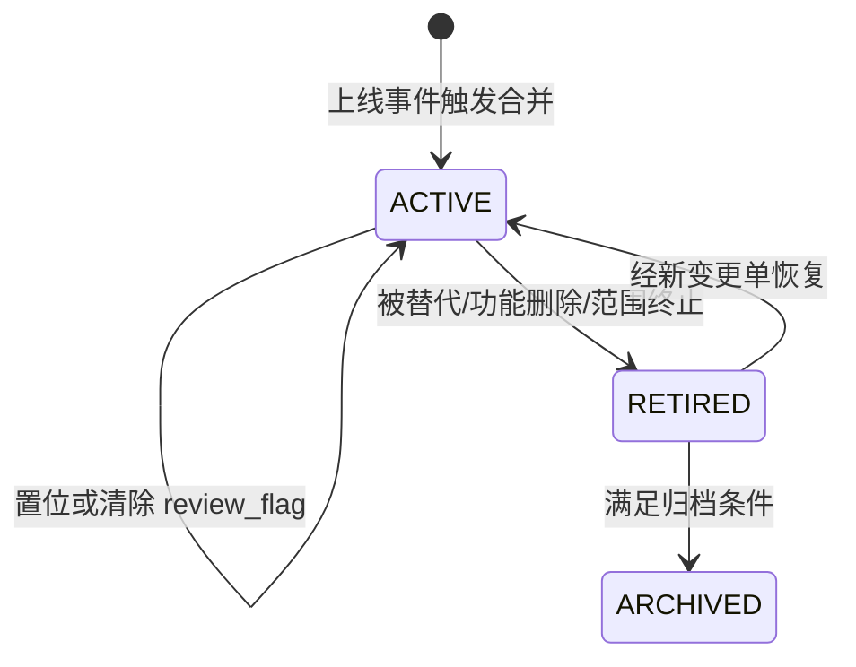
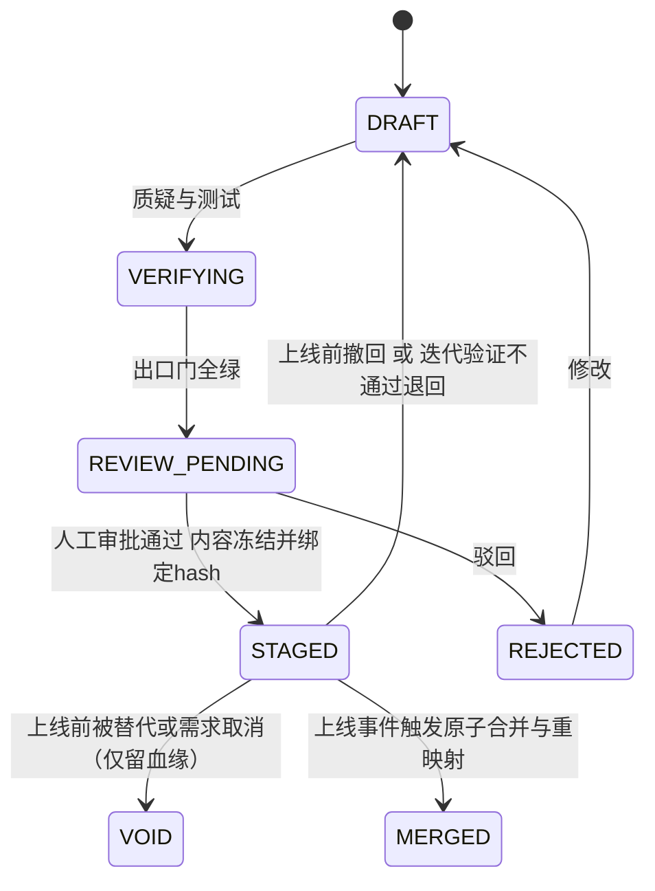
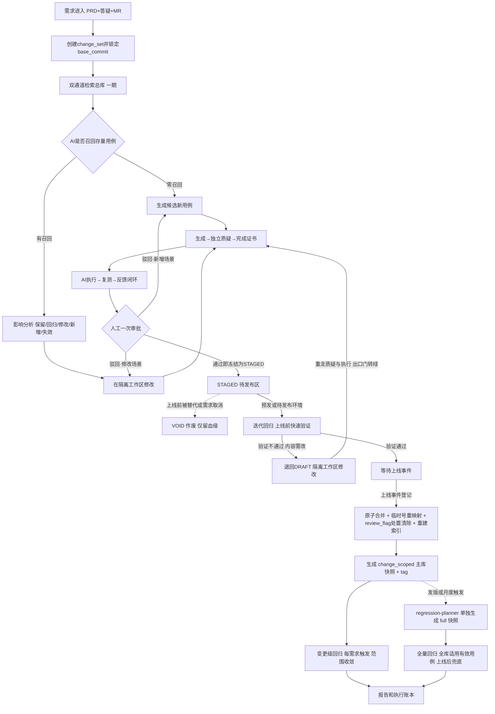

# AI 测试总用例库建设方案

**版本：** V2.5
**日期：** 2026-11-20
**适用范围：** 公司级多业务线、多租户、多客户版本的 AI 测试用例治理与回归执行

**V2.5 修订说明（相对 V2.4 的复核收口，逐条可追溯）：**

1. **乐观锁基线只认 `case_version`，治理元数据写入不误触发重审（V2.4 复核 A 级 1）**：V2.4 把 `review_flag` 置位交给库管理服务在合并事务外写 main，但 §18/§10.3 的乐观锁以 `base_commit` 比 HEAD 漂移，导致「给别的用例打个待复审标记」会让无关 `STAGED` 单基线过期、被判冲突重审，直接破坏 §17「每个 change_set 首次审批 1 次」。现确立乐观锁判定**只比对 `case_version`、忽略 HEAD 上治理元数据 commit**：§3.1 补「乐观锁基线只认 `case_version`」条款，§10.3 决策表加注预检只看覆盖性 `case_version`，§18 加专项风险，§17 加「误触发次数 = 0」硬指标。
2. **VOID 双来源分别校验，「需求取消」不再被门禁判非法（V2.4 复核 A 级 2）**：V2.4 §13.2 第 13 条要求「任何 `STAGED -> VOID` 均须有合并可行性预检来源」，但需求取消根本不登记上线事件、也就永不触发预检，最常见的「需求砍了」作废反而卡门禁。现将 §6.3 加 `void_reason`（`superseded`/`cancelled`），§10.3 补「需求取消 VOID」第二来源（凭取消依据 + 负责人确认、不经预检），§13.2 第 13 条改为双来源分别校验，§14 为 `cancelled` 单独赋权，§17 VOID 合法率随之分口径。
3. **引入「治理型变更单」承载无上线事件的合规写入（V2.4 复核 B 级 1）**：`case_applicability` 属定义字段、只能在合并事务内改，但存量迁移期把 `tenant_scope`/`customer_scope` 从 `PENDING_SCOPE` 补齐既无需求也无上线事件，全篇唯一生效通道（上线触发合并）使其永远补不进。现新增 `change_set_type = governance`：不带 `release_event`，以「审批通过 + 门禁通过」为生效触发，复用落库与索引重建（新增 §13.3 治理合并事务、§11.3 治理审批、`/apply-governance` 接口），既补通道又不破坏「主库只经合并事务改」的原则。§3.1/§3.2/§6.3/§7.2/§16-P2/§18 同步。
4. **待复审「跨窗口永久悬挂」补全收敛（V2.4 复核 B 级 2）**：V2.4 处置义务只约束「下一次相关变更单」，长期无需求触碰的稳定用例其 `review_flag` 会永久悬挂却测不出。现给待复审设**滞留时限**（默认 2 个迭代，§19 第 11 项拍板），超期未处置的由库管理服务自动生成「待复审清理」治理单（复用第 3 条）强制处置。§7.1/§13.2 第 12 条/§17/§18 同步。
5. **`full` 快照生成时机唯一化（V2.4 复核 B 级 3）**：V2.4 §13.1 第 6 步合并「生成快照」未标 kind、§9 图 `N` 同时喂 CR/FR、§10.2 又写「取最近合并快照作 `full`」，三处对「合并快照算 change_scoped 还是 full」口径不一，且「合并即 full」变相把全量回归拉回每需求触发。现明确**合并只产 `change_scoped`，`full` 快照由 `regression-planner` 在发版/月度对当时 HEAD 单独打**，§6.5/§9 流程图/§10.2/§12.1/§13.1 第 6 步同步修正。
6. **`PENDING_SCOPE` 在 §10.2 的双重表述统一（V2.4 复核 C 级 1）**：同节先写「禁止进入全量回归快照」、过渡口径又写「单列清单、不静默纳入也不静默丢弃」，纳入率分母算法自相矛盾。现统一为「**不作为执行条目、不计入分母，但单列待补清单**」的单一口径，§6.2/§10.2/§17 纳入率行同步对齐。
7. **VOID 单临时号封存规则补出（V2.4 复核 C 级 2）**：被 VOID 的变更单含未映射 `ADD` 新用例时，其 `temp_case_key` 永不重映射，却又撞上 §13.2 第 7 条「主库/索引无残留 `DRAFT-*`」门禁。现加 `void_sealed_temp_keys` 封存字段，明确其为第 7 条**显式豁免对象**（只校验不在主库 `cases/` 与索引、而在 `changes/void/` 血缘区）。§6.3/§13.1 第 7 步/§13.2 第 7 条同步。
8. **§3.1 治理元数据字段清单补 `review_flag_source`（V2.4 复核 C 级 3）**：V2.4 §3.1 只列 `review_flag`/`review_flag_reason`/`review_flag_epoch`，而 §6.1/§7.1 都把 `review_flag_source` 一并写入，「哪些字段可事务外写」不闭合。现补 `review_flag_source` 入清单。

---

**V2.4 修订说明（相对 V2.3 的复核收口，逐条可追溯）：**

1. **补齐 `review_flag` 置位的治理主体与事务归属（V2.3 复核 A 级 1）**：V2.3 只把待复审的**清除**严格放进合并事务，而**置位**的三个入口（回归 FAIL 分流、契约变更、巡检）却无主体，叠加 §14「AI 不可直改 main」与 `review_flag` 属主库 ACTIVE 用例字段，形成「清除受控、置位自由」的权限矛盾。现确立：`review_flag`/`review_flag_reason`/`review_flag_epoch` 为**治理元数据**（区别于只在合并事务内改的定义字段，新增 §3.1 边界条款）；置位由**库管理服务**作为唯一主体在合并事务外发起一次仅改元数据、记审计的受控写入，AI 只产出置位信号不得直写；清除仍并入合并事务，与置位形成对称闭环。§3.1/§6.1/§7.1/§14/§17/§18 同步。
2. **明确「被替代转 VOID」的判定规则与触发者，并与乐观锁冲突划清边界（V2.3 复核 A 级 2）**：V2.3 中「乐观锁冲突重审（仍 MERGED）」与「被整体替代转 VOID」两套并发处置并存却无判据、VOID 无触发者。现将 §18 的「合并可行性预检」由概念升格为正式步骤，给出被替代判定规则（同批次同 `case_id` 存在覆盖性更高 `case_version` → 判 VOID）、明确触发者为库管理服务产出 VOID 候选 + 测试负责人确认，并新增决策表区分「整体覆盖判 VOID（不上线）」与「基线过期判冲突重审（仍 MERGED）」；§13.2 追加 VOID 判定来源合规门禁。§10.3/§13.2/§14/§17/§18/§19 同步。
3. **明确 `PENDING_SCOPE` 仅约束全量回归（V2.3 复核 B 级 3）**：迭代回归（对象为本需求 STAGED 内容）与变更级回归（对象为本次合并涉及+受影响用例）按变更/影响范围圈定，不按租户/客户适用性四轴过滤，含 `PENDING_SCOPE` 存量用例照常纳入并标注待补。§10.1 补明。
4. **定义 `pre_release_iterative` 快照的条目主体（V2.3 复核 B 级 4）**：迭代回归在合并前、新用例仅有 `temp_case_key`，故该类快照允许以 `temp_case_key` 为主体标识新增条目，合并重映射后由库管理服务回填关联正式 `case_id`。§6.5 补明。
5. **全量回归整轮未触发改用 run 级 `SKIPPED`（V2.3 复核 C 级 5）**：区分 run 级执行状态（COMPLETED/SKIPPED/RUNNING）与用例级 `NOT_EXECUTED`，避免「整轮未跑」污染用例级纳入率分母。§6.5/§10.2 同步。
6. **§9 主干流程图补 `STAGED -> VOID` 出边（V2.3 复核 C 级 6）**：使 §4 注记「VOID 见 §7.2 与 §9」与实际图形一致。
7. **§5 `snapshots/` 目录注释涵盖三种 `snapshot_kind`（V2.3 复核 C 级 7）**。
8. **§10 引导语补迭代回归与变更级回归的定位区分（V2.3 复核 C 级 8）**：两档范围近似但目的与环境不同（预发验 STAGED 内容正确性 / 生产基线验集成不被破坏），不可互相省略。

---

**V2.3 修订说明（相对 V2.2 的复核收口，逐条可追溯）：**

1. **修正「迭代回归不通过」的退回路径（V2.2 复核硬伤 1）**：V2.2 的 §9 主干流程图把「迭代回归不通过」直接连到人工审批，绕过了 §11.1 审批提交门禁（独立质疑收敛 + 出口门全绿 + 执行闭环完成），而 §7.2 状态机的 `STAGED` 出口也没有这条边——照原图实现会做出「内容变了却未经质疑/出口门的人工审批」旁路。现统一为：迭代验证不通过 -> 退回 `DRAFT` 隔离工作区修改 -> 重走 `VERIFYING`（质疑 + 执行 + 复测）-> 出口门转绿 -> `REVIEW_PENDING` -> 人工审批并做 hash 校验。§4/§7.2/§9/§9.1/§9.2/§10.1/§11.1 全线对齐。
2. **补上 `review_flag` 判为 `UNAFFECTED` 时的清除载体（V2.2 复核逻辑缝 2）**：V2.2 §8.2 规定 `UNAFFECTED`「主库不动」、不进 §13.1 合并事务，而 §7.1 又要求「处置合入时清除待复审标记」，两者叠加会让待复审标记跨变更单永久悬挂、反复出现在每个审批包。现定义为：`UNAFFECTED` 的清除是一次**仅改 `review_flag` 元数据、不改定义字段、不递增 `case_version`** 的写入，并入该变更单的上线合并事务原子提交（新增 §13.1 第 5 步）；§13.2 追加「无待复审悬挂」门禁，§17 追加悬挂数指标，§8.2 同步改口径。
3. **收口「全量回归触发频率」自相矛盾（V2.2 复核实施缺口 3）**：V2.2 §9 主干把全量回归挂在每个需求上线合并之后（等于每需求把全库 P0~P3 跑一遍），与 §19 第 5 项「发版/月度全量回归」以及 §18「全量用例过多」风险直接冲突。现拆为三档执行：快照每次合并都生成（回归边界的事实源），执行分档——**迭代回归**（上线前、预发、验 `STAGED`）、**变更级回归**（每次上线合并后、范围收敛）、**全量回归**（发版/月度节奏、全库适用有效用例）。§2/§4/§6.5/§9/§9.1/§9.2/§10/§12/§17/§18/§19 与结论同步。
4. **修订说明第 13 条（V2.2）补全一次审批例外口径**：原只写「乐观锁冲突」一类，漏了 §17 正文与 §11.2 中的「上线前内容变更」一类；V2.3 再纳入「上线前迭代回归不通过退回重提」，三例并列，且都必须先满足 §11.1 门禁。
5. **§4 架构图补 VOID、撤回/退回、驳回分流三条边的指引注记**：架构图只画主干，这三条状态边在 §7.2 状态机与 §9 流程图中给出，加指针避免被误读为缺失。

---

**V2.2 修订说明（相对 V2.1 的历史收口，逐条可追溯）：**

1. **删除冗余的 `APPROVED` 停留态**：审批通过即 `STAGED`（内容冻结 + 待发布），全文（状态机、流程图、正文、审批章）统一为一套口径，不再有「先 APPROVED 再无条件转 STAGED」的空转边（原 V2.1 矛盾 1）。
2. **拆分「迭代回归 / 全量回归」两个执行时点**：迭代回归发生在**上线前**（`STAGED` 内容在待发布/预发环境跑本需求验证），全量回归发生在**上线合并后**（基于主库不可变快照）。§9 流程图、§9.1、§9.2、§10.1、§10.3 全部按此对齐（原矛盾 2、3）。
3. **优化场景（§9.2）补齐迭代回归步骤**，与主干流程一致（原矛盾 3）。
4. **`PENDING_SCOPE` 补齐时点统一为「P2 结束前」**，验收指标随之改口径，与 P3 存量迁移解耦（原矛盾 4）。
5. **「全量纳入率 100%」加过渡口径**：P2 前按业务线 + 起始版本两轴判定适用，全四轴 100% 自 P2 补齐起计（原矛盾 5）。
6. **取消 §10.3「沿用原评审结论不重审」的歧义表述**：被替代的 `STAGED` 变更转 `VOID`（作废），其评审结论与缺陷记录仅作血缘留痕、不构成主库生效依据；若内容仍需上线，作为新变更单重审，与 §11.2「内容变必重审」不再对立（原矛盾 6）。
7. **新增 §13.1「合并事务与临时号 → 正式 `case_id` 原子重映射」**，明确引用同步改写、断链检测，并在 §13.2 门禁追加「重映射完整性」校验项（原缺口 7）。
8. **定义 `review_flag=待复审` 的置位与清除入口**（谁、何时、如何清除），不再「有字段无写路径」（原缺口 8）。
9. **定义 `ARCHIVED` 的归档条件、触发者与恢复路径**，状态机不再使用未定义谓词（原缺口 9）。
10. **上线事件可靠性列入 §18 风险表**并给出滞留降级策略（超时限强制提醒/回退）（原缺口 10）。
11. §2 目标 4 标注「代码路径检索为二期可选」，与 §8.1 范围一致（原轻微 1）。
12. §9 流程图审批驳回边按场景分流：有召回场景回「隔离工作区修改」，纯新增场景回「生成候选新用例」（原轻微 2）。
13. §17「一次审批」指标补充「乐观锁冲突重审 + 上线前内容变更重审」两类例外口径，与 §18 并行迭代对策、§11.2 一致（V2.1 二阶副作用；V2.3 再补「上线前迭代回归不通过退回」一类，见 V2.3 修订说明第 4 条）。

---

## 1. 背景

现有 AI 测试 Agent 已覆盖：

> 需求 → 答疑 → 用例生成 → 独立质疑 → 交付物 → AI 执行 → 问题反馈 → AI 复测 → 问题分流和优先级判断 → 人工复核

`agentqa_test` 已具备 generator、challenger、cert gate、executor、feedback-loop、SYS/DEF/IMP/CHG 血缘、失效标识和替代指针等能力。当前缺少一个跨需求、跨版本的公司级用例正本，主要问题是：

- 用例按需求册分散，Agent 难以复用和判断影响面；
- 优化需求中旧用例的冻结、替代和失效缺少统一事务；
- 回归集依赖人工组装，不能保证全部有效用例被纳入；
- 业务线、租户和客户版本的适用范围没有结构化。

## 2. 建设目标

1. 按单条用例管理，每条用例拥有全局唯一、终身不变的 `case_id`。
2. 一套总库支持多业务线、多租户和多客户版本。
3. 支持新增、修改、替代、失效和恢复，且完整保留历史。
4. 支持 Agent 按结构化条件、关键词和语义检索（代码路径/MR 映射为二期可选增强，见 §8.1）。
5. 每个变更单只进行一次人工入库审批（乐观锁冲突重审例外见 §17）。
6. 上线事件触发原子合并新旧状态，不留覆盖空窗；审批通过只做内容定谳并冻结为待发布态，未上线内容不进主库。
7. 全量回归执行目标范围内全部适用且有效的用例；全量回归按发版/月度节奏触发，每次上线合并后另触发范围收敛的变更级回归承担快速反馈（见 §10）。
8. 实现「需求 → 用例 → 变更 → 执行 → 缺陷 → 审批」全链路追溯。

## 3. 核心原则

### 3.1 单一正本

- Git 仓库是用例定义、版本变更和审批记录的审计正本。
- SQLite/PostgreSQL 是由 Git 构建的检索索引，不是第二份正本，必须可全量重建。
- Markdown、XMind、XLSX 是生成和阅读视图，不反向覆盖总库。
- 执行结果写独立执行账本，不覆盖用例定义。
- **定义字段与治理元数据的边界（V2.4 新增，V2.5 补全清单）**：用例的 `title`/`steps`/`expected_results`/`priority`/`status` 等**定义字段**只在合并事务（§13.1 上线合并 / §13.3 治理合并）内变更；`review_flag`/`review_flag_reason`/`review_flag_source`/`review_flag_epoch` 属**治理元数据**，其置位可由库管理服务在合并事务之外执行一次仅改元数据、记审计的受控写入（§7.1、§14），其清除仍并入合并事务（§13.1 第 5 步）。置位「受控写」、清除「受控清」二者主体、事务与留痕对称，从根上消除「清除受控、置位自由」的权限矛盾。
- **`case_applicability` 的特殊性与治理型变更单（V2.5 新增）**：`case_applicability` 属定义字段、决定用例能否进入回归快照，故不能在合并事务外随手改写；但存量迁移期把 `tenant_scope`/`customer_scope` 从 `PENDING_SCOPE` **补齐**为真实值这一动作，既不来自需求/MR、也没有上线事件触发合并——若强行套用「上线事件触发合并」这一唯一生效通道，将永远补不进。为此 V2.5 引入**治理型变更单**（`change_set_type = governance`，见 §6.3/§7.2/§11.3/§13.3）：它不带 `release_event`，以「测试负责人审批 + 门禁通过」为生效触发，复用落库与索引重建步骤，专用于适用范围补齐、编号勘误等纯治理性定义字段变更。
- **乐观锁基线只认 `case_version`（V2.5 新增，回应 V2.4 复核 A 级 1）**：`base_commit` 锁定的是「**定义字段版本基线**」。库管理服务在合并事务外为别的用例写 `review_flag` 等治理元数据，虽在 main 上产生新 commit，但**不递增任何用例的 `case_version`**；因此变更单冲突判定一律以「本单涉及的每个 `case_id` 的 `case_version` 在基线锁定后是否被他人递增」为准，**不以 main 的 HEAD 是否移动为准**。治理元数据 commit 不计入基线漂移，无关的 `STAGED` 单不会因他人打待复审标记而被误判冲突重审，从而守住 §17「每个 change_set 首次审批 1 次」。

### 3.2 变更隔离

- AI 只在「变更工作区」修改候选版本，上线合并前主库当前版本继续有效。
- 「变更中」「已定谳/待发布」都属于变更单状态，不是主库用例状态。
- 新版本生效、旧版本失效和替代关系建立必须在上线触发的同一事务提交，并同时生成不可变快照。
- 治理型变更单（`governance`，§6.3）是唯一不带上线事件的合规写入通道，仅限适用范围补齐、编号勘误等纯治理变更，仍走「人工一次审批 + §13.2 机器门禁」后在治理合并事务（§13.3）内落库，不开「脱离合并事务随手改主库」的口子（§3.1）。

### 3.3 AI 建议、人工定谳

- AI 负责检索、影响分析、生成、质疑、执行、复测和差异说明。
- 人工只在入库前审批一次，同时审核新增、修改、失效、替代关系和适用范围；审批通过后内容冻结在待发布区（`STAGED`），由上线事件决定何时生效。
- AI 不得因为「系统当前就是这样」自行修改预期结果。

## 4. 总体架构



> 架构口径（V2.3 三档）：**迭代回归**挂在 `STAGED`（上线前、预发环境）这一支；上线合并后即时触发的是范围收敛的**变更级回归**；**全量回归**只在发版/月度节奏基于主库不可变快照触发。三档的时点、范围与环境互不混用。
> 本图为主干视图：`STAGED -> VOID`（上线前被替代/需求取消）、`STAGED -> DRAFT`（上线前撤回或迭代验证不通过退回）、以及审批驳回边按「新增场景回生成 / 修改场景回隔离工作区」的分流，这三条状态边不在架构图重复绘制，完整边集见 §7.2 变更单状态机与 §9 主干流程图。

### 4.1 与现有 Agent 的关系

```text
Agent本体/      流程与技能
手艺包/         通用方法、标准与门禁
公司包/         公司路径、业务线、环境与适配器配置
总用例库/       公司测试用例资产正本（独立Git仓库）
执行记录/       账本、截图、报文、报告和缺陷证据
```

`agent-company.json` 增加 `paths.总用例库`、`paths.用例索引`和 `paths.用例变更工作区`。

### 4.2 与现行标准体系的对齐

**定位**：本方案定**工程实现**（正本载体、变更事务、编号与索引），`aiagentqa_test/公司包/标准体系/` 定**内容口径**（用例定义、五列表、优先级、状态术语、断言与执行集）。冲突时内容口径以标准正本为准、工程约束以本方案为准；任一方变更须拍板并同步《00_标准体系索引》版本矩阵。

**标准锚点**：

| 标准 | 现行版本 | 本方案消费其内容 |
|---|---|---|
| L1《通用用例设计标准》 | v1.8（2026-11-11） | §1 用例定义、五列表、P0123 四级、§22 设计方法、§23 预期结果可判定 |
| 专项《总用例库建设规范》 | 文内 v1.1（2026-11-11） | 入库门槛、库分层、生命周期、UI/接口血缘、6 项健康度指标 |
| L6《测试用例执行集裁剪与优先级规范》 | v1 | 冒烟/回归/全量/变更四级执行集、就绪度六项、P3 口径 |
| L6《测试执行结果判定标准》 | 内容修订 v1.2 | PASS/FAIL/NOT_EXECUTED/BLOCKED 四态语义与证据要求 |
| L7 手艺包《AI自动化测试用例编写标准》 | v4.0 | 对外分发字段：标题格式、测试数据表、后置清理、自动化标记 |

**五条对齐映射**：

| # | 差异 | 处置 |
|---|---|---|
| 1 | **用例 ID**：标准为 `TC-{模块缩写}-{序号}` 标题编号 + 册级 vX.Y；本方案为全局 `case_id` + `case_version` | `legacy_ids` 保留原 TC 编号及所属册名/版本；`case_id` 仅在本库内部使用，渲染视图继续输出 TC 标题格式，存量报告与缺陷引用不断链 |
| 2 | **状态术语**：库规三为 `草稿/现行/待复审/失效` + 标题划线〔已失效〕；本方案为 ACTIVE/RETIRED/ARCHIVED（变更单另有 DRAFT…MERGED/VOID） | 映射：草稿→变更单 DRAFT/VERIFYING；现行→ACTIVE；待复审→ACTIVE + `review_flag=待复审`（置位/清除见 §7.1）；失效→RETIRED。本方案无物理删除，与标准「失效不删」一致；标题划线〔已失效〕仍由渲染器输出供人读 |
| 3 | **P3 与执行集**：本方案 §10.2 全量快照 P0~P3 全进；执行集规范 P3 默认不进日常回归 | 不冲突：本方案「全量回归」对应规范「全量集/专项验收」；V2.3 新增的「变更级回归」对应规范「变更集」（`snapshot_kind = change_scoped`），仍按规范裁剪（P0 必跑、P3 默认不进）；上线前的迭代验证对应规范「冒烟/回归集」的预发子集。报告须标注本轮属于哪一集，避免被读成推翻现行规矩 |
| 4 | **基础数据**：标准明确 PRE-xx 为「执行前数据准备（非用例）」，不计入用例总数；本方案原数据模型无此位置 | 数据准备独立存储，用例侧只以 `data_refs` 关联；PRE-xx 不占用 `case_id`，统计口径沿用标准（PRE 不计入用例总数） |
| 5 | **治理与血缘字段**：库规五要求执行数据带 `risk_id/case_priority/test_depth/nfr_dimension/execution_set/release_criterion_id/observation_metric/residual_risk`；接口血缘要求 `{源UI用例编号,源步骤号,菜单,租户,采集时间,采集执行ID}` | `execution_result` 补齐 8 个治理字段（§6.5）；`case_relation` 承载接口血缘并保留源 UI 用例编号/步骤号（§6.4）；执行四态沿用 L6 判定标准 |

## 5. 仓库结构

```text
total-case-library/
├── cases/
│   └── <business-line>/<domain>/<module>/shard-0001.yaml
├── changes/
│   ├── staging/      # STAGED 已定谳待发布变更单
│   ├── void/         # VOID 上线前作废变更单（仅血缘留痕）
│   └── merged/       # 已合并变更单和审批证据
├── relations/        # 需求、迭代、用例、替代与临时号映射关系
├── snapshots/        # 回归快照：pre_release_iterative / change_scoped / full 三种
├── schemas/          # Schema、状态机和机检规则
├── renderers/        # YAML→MD/XMind/XLSX
└── migrations/       # 索引和数据迁移脚本
```

管理粒度是单条用例，但不强制一条一文件。按模块分片可避免十万级小文件拖慢 Git。现有 Markdown 五列表（前置条件/操作步骤/预期结果/判断依据/测试方法，L1 §1）入库时拆成单条结构化用例，总库可再渲染出 Markdown/XMind/XLSX；PRE-xx 数据准备按 §4.2 第 4 条独立存储，不进 `cases/`。

## 6. 数据模型

### 6.1 用例 `test_case`

| 字段 | 说明 |
|---|---|
| `case_id` | 全局唯一，上线合并时分配，终身不复用 |
| `temp_case_key` | 待发布期临时号 `DRAFT-<iteration>-<sequence>`，合并后封存并写入 `temp_id_map`（§13.1），不再对外引用 |
| `case_version` | 从 1 递增；修改不改 `case_id` |
| `title` | 单一测试目的 |
| `preconditions` | 可准备、可判断的前置 |
| `steps` | 有序、可执行步骤 |
| `expected_results` | 与步骤对应的可观测预期 |
| `basis_refs` | PRD、答疑、标准、接口或代码依据 |
| `priority` | P0/P1/P2/P3；只影响顺序，不决定是否进全量 |
| `case_type` | UI/API/E2E/性能/安全/人工等 |
| `automation_mode` | auto/ai/manual_only |
| `status` | ACTIVE/RETIRED/ARCHIVED |
| `review_flag` | 空/待复审；治理元数据，置位主体与事务归属见 §3.1、§7.1、§14，不新增主库状态 |
| `review_flag_reason` | 待复审置位原因（三入口之一），随置位写入 |
| `review_flag_source` | 触发来源（回归执行 ID / 契约或标准条目 / 巡检批次），随置位写入 |
| `review_flag_epoch` | 待复审置位的受控写入序号，仅由库管理服务递增（不改 `case_version`），用于置位可追溯对账 |
| `source_requirement_ids` | 需求来源，允许多值 |
| `data_refs` | 关联的 PRE-xx 数据准备（非用例，不计入用例总数） |
| `legacy_ids` | 迁移前的原编号（含 `TC-{模块}-{序号}` 及册名/版本） |

### 6.2 适用范围 `case_applicability`

| 字段 | 说明 |
|---|---|
| `business_lines` | 适用业务线集合 |
| `tenant_scope` | ALL、租户类型或指定租户 |
| `customer_scope` | STANDARD、指定客户或排除客户 |
| `product_version_from` | 起始产品版本 |
| `product_version_to` | 终止版本，空表示持续有效 |
| `environment_constraints` | 环境、开关、依赖和数据限制 |

适用范围必须结构化并通过 Schema 校验，不允许只写自由文本标签。

**分级必填**：试点期（P0/P1）只强制 `business_lines` 与 `product_version_from`；`tenant_scope` 与 `customer_scope` 在过渡期显式标为 `PENDING_SCOPE`，**P2 结束前必须补齐**（全库唯一口径，P3 存量迁移按业务线切换时不得晚于该用例所属业务线上线前补齐）。`PENDING_SCOPE` 用例在全量回归中**不作为执行条目、不计入执行分母**（即「不纳入本轮全量执行范围」），但必须单列进「待补范围清单」独立对账，任何阶段都不得默认 `ALL`，也不得静默丢弃。其纳入/排除的唯一口径见 §10.2、§17，禁止出现「既禁入快照又计入分母」的双重表述。

### 6.3 变更单 `case_change_set`

```text
change_set_id, iteration_id, requirement_ids, base_commit
change_set_type: feature（随上线生效，默认） / governance（治理型，无上线事件，V2.5 新增）
status: DRAFT / VERIFYING / REVIEW_PENDING / STAGED / MERGED / REJECTED / VOID
release_event_id, target_release_version   # governance 单此两字段为空
void_reason: superseded（被替代） / cancelled（需求取消）   # 转 VOID 时必填，V2.5 新增
void_sealed_temp_keys: [DRAFT-<iteration>-<sequence> ...]   # VOID 单内未映射临时号的封存清单（V2.5 新增）
add_case_ids, modify_case_ids, retire_case_ids, impact_case_ids
temp_id_map: {DRAFT-<iteration>-<sequence> -> case_id}
verification_refs, approval_record
```

- 审批通过即进入 `STAGED`：内容冻结、绑定审批 hash、登记目标上线批次；不存在独立的「审批通过但未待发布」停留态。
- 上线事件登记后由 `STAGED` 转 `MERGED`，同一事务完成合并、临时号重映射、快照与 tag。
- `VOID`：`STAGED` 变更单在其内容被其它上线批次整体替代（`void_reason = superseded`）、或该需求最终不上线被取消（`void_reason = cancelled`）时作废，仅保留评审与缺陷血缘留痕，不构成主库生效依据（见 §10.3）。两种来源的合规凭证不同，§13.2 第 13 条分别校验。
- **VOID 单的临时号封存（V2.5 新增，回应 V2.4 复核 C 级 2）**：若被 VOID 的变更单含尚未映射的 `ADD` 新用例，其 `temp_case_key` 从未进入主库、也永不重映射为正式 `case_id`，必须在转 VOID 时一并写入 `void_sealed_temp_keys` 封存并标注来源为该 VOID 单。这类留痕性 `DRAFT-*` 引用是 §13.2 第 7 条「主库/索引无残留悬空引用」门禁的**显式豁免对象**——它只存在于 `changes/void/` 血缘区，不得出现在主库 `cases/` 与检索索引中。
- `governance` 型变更单不登记 `release_event`，审批通过 + 门禁通过即为生效触发（§13.3），专用于适用范围补齐等纯治理变更。

### 6.4 血缘和迭代关系

`case_relation` 支持 `REPLACES`、`DERIVED_FROM`、`COVERS_WITH`、`DEPENDS_ON`。接口用例血缘按库规四保留 `{源UI用例编号, 源步骤号, 菜单, 租户, 采集时间, 采集执行ID}` 结构化字段，不以自由文本表达。

`case_iteration_relation` 使用 `case_id + iteration_id + relation_type`，其中 `relation_type = ADDED / MODIFIED / IMPACTED / REGRESSION`。不将多个迭代号持续追加到一个 `iter_tag` 字段中。

待发布期所有指向新用例的血缘、缺陷、需求引用一律先用 `temp_case_key` 记录，正式 `case_id` 在合并事务内按 `temp_id_map` 统一改写（§13.1），改写后 `temp_case_key` 引用不得残留。

### 6.5 回归快照和执行账本

- `regression_snapshot`：快照 ID、Git commit、目标业务线/租户/客户/版本、条目主体（`case_id + case_version` 或合并前的 `temp_case_key`）、`snapshot_kind`（pre_release_iterative / change_scoped / full）。
- **三种快照的生成时机（V2.5 明确，回应 V2.4 复核 B 级 3）**：`pre_release_iterative` 由迭代回归在上线合并前的预发环境生成（对象为 `STAGED` 内容）；**每次上线合并事务只产 `change_scoped` 快照**（§13.1 第 6 步，绑定紧随其后的变更级回归）；`full` 快照**不由合并产生**，而是在发版/月度窗口由 `regression-planner` 对当时的主库 HEAD 单独打一份并绑定全量回归执行（§10.2、§12.1）。即「合并 = change_scoped，发版/月度 = full」，二者不混用，杜绝「每需求合并都生成 full 快照」的成本失控。
- **`pre_release_iterative` 快照的条目主体（V2.4 新增）**：迭代回归发生在上线合并之前，此时本需求新增用例仅有 `temp_case_key`（§9.1 第 3 步）而无正式 `case_id`。故该类快照**允许以 `temp_case_key` 作为新增条目的主体标识**（存量/受影响条目仍为 `case_id + case_version`）；合并事务完成 `temp_id_map` 重映射后（§13.1 第 3 步），由库管理服务把对应迭代回归的 `execution_result` 回填关联到正式 `case_id`，保证「预发验临时号 → 线上溯正式号」闭环；`temp_case_key` 在封存前不得作为快照主体对外长期引用。
- `execution_run`：快照 ID、环境、范围和开始结束时间；**含 run 级执行状态** `run_status`（COMPLETED / RUNNING / SKIPPED）。`SKIPPED` 专用于「本轮按节奏应触发但无新合并基线可跑」等**整轮未执行**情形（§10.2），与**用例级** `NOT_EXECUTED`（指某条用例在已执行 run 中未跑，L6 判定标准）分层，二者不得混用。
- `execution_result`：PASS/FAIL/NOT_EXECUTED/BLOCKED（语义沿用 L6 判定标准）、证据和缺陷关联；并携带库规五 8 个治理字段：`risk_id`、`case_priority`、`test_depth`、`nfr_dimension`、`execution_set`、`release_criterion_id`、`observation_metric`、`residual_risk`。

## 7. 状态机

### 7.1 主库用例



主库不设 DRAFT、REVIEW_PENDING、「变更中」或「已定谳/待发布」；它们属于变更单。与库规三 `草稿/现行/待复审/失效` 的术语映射见 §4.2 第 2 条；「待复审」以 `review_flag` 承载，不扩充主库状态集。

**`review_flag=待复审` 的置位与清除（V2.2 定义）**：
- 置位的**信号**来自三处：① 回归执行 FAIL 且问题分流判定为「用例本身过时」而非产品缺陷；② 所依赖的标准/接口契约/数据准备变更触发影响复核；③ 库管理健康度巡检周期命中。**置位动作统一由库管理服务执行**（§14 唯一可写主体）：AI Agent 与执行分流只产出「置位信号」，**不得直写主库 `review_flag`**；库管理服务据信号对主库 ACTIVE 用例发起一次**仅改治理元数据**（`review_flag` + `review_flag_reason` + `review_flag_source`，并递增 `review_flag_epoch`，见 §3.1 定义字段/治理元数据边界）的受控写入，写审计日志、不改定义字段、不递增 `case_version`。清除仍走合并事务（§7.1 处置义务、§13.1 第 5 步），与置位形成「受控写、受控清」的对称闭环——解决 V2.3「清除受控、置位自由」与 §14「AI 不可直改 main」的权限矛盾。
- `review_flag=待复审` 的用例在下一次相关变更单的审批包中必须显式处置（`MODIFY`/`UNAFFECTED`/`RETIRE` 之一并附理由）。三类处置的**清除载体**不同，V2.3 明确如下，以消除「UNAFFECTED 主库不动 -> 标记永久悬挂」的逻辑缝：
  - `MODIFY`：随新 `case_version` 生效，在同一上线合并事务内清除；
  - `RETIRE`：随用例转 `RETIRED`，在同一上线合并事务内清除；
  - `UNAFFECTED`：用例定义内容不动、不递增 `case_version`，但**清除本身是一次独立且必需的主库写入**——只改 `review_flag` 元数据字段，并入该变更单的上线合并事务原子提交（见 §13.1 第 5 步），并在审批包 `verification_refs` 留痕。
- 故「UNAFFECTED = 主库不动」仅指**用例定义字段**不动；`review_flag` 属治理元数据，处置即清，不得跨变更单累积悬挂。
- 处于待复审的用例仍按 ACTIVE 参与全量快照，不得因待复审而被静默剔除（`PENDING_SCOPE` 者除外，按 §6.2/§10.2 口径不进分母）。
- **待复审的滞留兜底（V2.5 新增，回应 V2.4 复核 B 级 2）**：上述处置义务只约束「下一次**相关**变更单」，无法覆盖「被打上待复审后长期没有任何需求/优化触碰」的稳定模块用例——这类标记会跨窗口永久悬挂却测不出。故对 `review_flag=待复审` 设**滞留时限**（默认 2 个迭代周期，取值待 §19 第 11 项拍板）：自 `review_flag_epoch` 置位起，超期仍未进入任何相关变更单显式处置的，由库管理服务自动生成一张**「待复审清理」治理型变更单**（`change_set_type = governance`，§6.3/§13.3），列出全部超期悬挂用例，强制走一次人工审批（判定为 `MODIFY`/`UNAFFECTED`/`RETIRE` 并清除标记），使其纳入 §17「悬挂数 = 0」的可收敛闭环。同时明确：治理元数据置位不递增 `case_version`，**不得被任何 `STAGED` 单误读为乐观锁冲突**（§3.1、§10.3）。

**`RETIRED -> ARCHIVED` 归档条件（V2.2 定义）**：同时满足以下四条方可归档，由库管理定时任务批量执行、生成归档记录：
1. `RETIRED` 状态已持续满保留年限（默认值待 §19 第 6 项拍板）；
2. 无任何未关闭缺陷关联；
3. 无任何指向本用例的活跃引用（`case_relation` 中无 ACTIVE 用例依赖它，`legacy_ids`/TC 引用已在渲染层闭环）；
4. 归档动作经测试负责人确认。
归档后用例转为只读，仍可按 `case_id` 检索取证，但默认不进入任何快照；恢复为 ACTIVE 必须通过新的变更单重走一次审批，不提供直接反归档操作。

### 7.2 变更单



变更单不再有独立的 `APPROVED` 态：审批通过的那一刻即 `STAGED`，避免状态机出现无触发事件的空转边、避免审计多记一次无意义流转。

**`STAGED -> DRAFT` 的两条真实触发（V2.3 明确）**：① 测试负责人上线前主动撤回；② **迭代回归（上线前预发验证）不通过**。两种情形都意味着内容需要改动，必须退回 `DRAFT` 重走 `VERIFYING`（独立质疑 + 执行 + 复测）并以「出口门全绿」重新进入 `REVIEW_PENDING`，**不存在从 `STAGED` 直接跳到人工审批的边**——否则会出现「内容变了却绕过 §11.1 提交门禁」的旁路，破坏审批作为唯一实质闸口的语义。

**治理型变更单的状态流（V2.5 新增）**：`governance` 单复用上述状态机，但**没有 `STAGED`→上线事件→`MERGED` 这一支**——它不登记 `release_event`，审批通过即 `STAGED`（内容冻结、绑定 hash），紧接着由「审批通过 + 门禁通过」直接触发 §13.3 治理合并转 `MERGED`，全程无上线事件、无迭代回归、无变更级回归。其 `STAGED` 出口只有「治理合并」与「撤回」两条，不存在 `VOID`（治理单无上线批次，谈不上被替代；如发现补错范围，按撤回回 `DRAFT` 重做）。

## 8. 检索和影响分析

### 8.1 检索通道（分期）

**一期（P0–P2）双通道**：

1. **结构化过滤**：业务线、系统、域、模块、功能点、租户、客户版本、状态。
2. **文本检索**：关键词/BM25 与语义向量召回。

**二期可选增强**：

3. **代码路径映射**：MR 文件、服务、接口、页面路由、数据表与用例映射——待开发侧 MR 规范建立后接入，不作为一期前置条件。

一期两路取并集、二期三路取并集后排名，AI 再逐条判定。语义相似度只用于召回，不直接决定失效。`0.75` 可作为初始值，但必须用真实需求集评估召回率后校准；同义词表（如「改单≈修改运单≈地址变更」）持续沉淀。

### 8.2 AI 判定结果

| 判定 | 动作 |
|---|---|
| `UNAFFECTED` | 用例定义内容不动、不递增 `case_version`；若该用例带 `review_flag`，须以仅改元数据的写入清除并并入合并事务（§7.1、§13.1 第 5 步），不得留悬挂标记 |
| `REGRESSION_ONLY` | 纳入迭代回归，不修改定义 |
| `MODIFY` | 在变更区创建新 `case_version` |
| `ADD` | 创建候选新用例 |
| `RETIRE` | 提议失效，给出原因和替代指针或无替代理由 |
| `UNCERTAIN` | 进入答疑，不自行处置 |

## 9. 统一流程



### 9.1 全新功能

1. 需求答疑收口，创建 `change_set`。
2. 检索总库，即使零命中也保留检索证据。
3. AI 生成候选用例，使用 `DRAFT-<iteration>-<sequence>` 临时号。
4. 通过 generator → challenger → cert gate → executor → feedback-loop。
5. 人工一次审批内容、适用范围和执行证据，通过后内容冻结为 `STAGED`，不入库。
6. **上线前迭代验证**：`STAGED` 用例在待发布/预发环境执行迭代回归，验证本需求新增条。**不通过的处理（V2.3 修正）**：内容需要改动时退回 `DRAFT` 在隔离工作区修改，重走独立质疑与执行闭环、出口门转绿后再次提交人工审批并做 hash 校验；**不得绕过质疑与出口门直送审批**。
7. 需求上线事件触发合并：分配正式 `case_id`、按 `temp_id_map` 重映射全部引用、清除本变更单已显式处置的 `review_flag`（§13.1 第 5 步）、原子入库为 ACTIVE。
8. 合并同一事务生成主库不可变快照与 tag；**上线合并后立即触发的是范围收敛的变更级回归**，全库 `P0~P3` 全量回归按发版/月度节奏触发（§10.2）。

### 9.2 优化已有功能

1. 在 `base_commit` 上召回存量用例。
2. AI 逐条标注 `UNAFFECTED/REGRESSION_ONLY/MODIFY/ADD/RETIRE/UNCERTAIN`。
3. MODIFY 用例复制到隔离区生成新版本，主库原版本继续 ACTIVE。
4. RETIRE 只记入变更提案，审批前不改主库。
5. 修改和新增用例完成质疑、执行、复测与反馈闭环。
6. 人工一次审批差异、失效原因、替代指针和适用范围；通过后冻结为 `STAGED`，主库不动。
7. **上线前迭代验证**：`STAGED` 的新增/修改/受影响用例在预发环境执行迭代回归（含同机制兄弟场景与正向对照条）；不通过按 §9.1 第 6 步退回 `DRAFT` 重走质疑与出口门后再审批，不得直送审批。
8. 需求上线事件触发：同一事务内新版本生效、新用例生效（临时号重映射）、被替代用例转 `RETIRED`、被处置为 `UNAFFECTED` 的待复审用例清除 `review_flag`、血缘落库。
9. 合并生成主库快照后触发**变更级回归**；基于主库不可变快照的**全量回归按发版/月度节奏**执行；未上线的 `STAGED` 用例不进主库基线回归。

### 9.3 功能删除与紧急修复

- 功能删除：可批量提议 RETIRE，但必须保留需求依据和影响清单。
- 紧急修复：可缩短首轮执行范围，但不取消一次审批、原子合并和后续全量回归义务。

## 10. 回归策略

> **三档执行，时点互不混用**（V2.3 对齐 §9）：**迭代回归** = 上线前、预发/待发布环境、对象是 `STAGED` 内容；**变更级回归** = 每次上线合并后、基于该次合并新生成的主库快照、范围收敛（本变更关联用例 + 受影响用例 + 同链路 P0 核心）；**全量回归** = 发版/月度节奏触发、基于主库不可变快照、覆盖目标范围内全部适用且有效的用例。**快照每次合并都生成（回归边界的事实源），但执行频率分档**，以化解「每需求跑一遍全库」与执行成本之间的矛盾。迭代回归与变更级回归的**圈定范围高度相似但目的与环境不同、不可互相省略**：迭代回归在**预发环境**验「`STAGED` 待发布内容本身是否正确」（上线前，对象是尚未入库的候选内容，拦截内容错误于上线之前）；变更级回归在**生产基线快照**上验「这批变更合入后基线集成是否被破坏」（上线后，对象是已生效的新基线，拦截集成回归于上线之后）。

### 10.1 迭代回归

- **时点与环境**：在 `STAGED` 阶段、待发布/预发环境执行，属**上线前**快速验证。
- **范围**：本迭代新增、修改、受影响用例，同机制兄弟场景、正向对照条和相关 P0 核心链路。
- 迭代回归既不替代上线合并后的变更级回归，也不替代发版/月度的全量回归；`STAGED` 内容不参与主库基线，仅在预发环境验证。
- **`PENDING_SCOPE` 不影响迭代/变更级回归（V2.4 新增）**：`PENDING_SCOPE` 仅约束**全量回归快照**（§10.2）。迭代回归对象是本需求 `STAGED` 的新增/修改内容（范围由变更本身圈定），变更级回归对象是本次合并涉及的用例 + 受影响用例（范围由影响分析圈定），两档均**按变更/影响范围圈定，不按租户/客户适用性四轴过滤**；若含 `tenant_scope`/`customer_scope = PENDING_SCOPE` 的存量受影响用例，照常纳入这两档执行并在报告标注其租户/客户适用性待补，不因待补而静默剔除。
- **不通过的退回路径（V2.3）**：迭代回归不通过一律按 §7.2 走 `STAGED -> DRAFT` -> `VERIFYING` -> 出口门全绿 -> `REVIEW_PENDING` 重审，**系统不存在「验证不通过直接进人工审批」的路径**；退回后提交审批仍受 §11.1 门禁与 §13.2 第 10 条拦截。

### 10.2 全量回归

```text
status = ACTIVE
AND 适用于目标业务线
AND 适用于目标租户
AND 适用于目标客户/标准版
AND 目标产品版本在用例有效区间
```

- **触发时机（V2.3 收口，V2.5 修正快照来源，回应 V2.4 复核 B 级 3）**：全量回归**按发版或月度节奏触发**，不在每个需求上线合并后触发。每次上线合并即时触发的是**变更级回归**（合并事务只产 `change_scoped` 快照）。发版/月度窗口时，由 `regression-planner` 对**当时的主库 HEAD 单独生成一份 `full` 快照**并绑定全量回归执行——`full` 快照不复用某次合并的 `change_scoped` 快照（V2.4「取最近合并快照作 full」的表述据此废止），以免「合并即 full」变相把全量回归拉回每需求触发。该发版/月度窗口内若主库 HEAD 自上次全量后无任何合并、无新基线可跑，可跳过本轮或沿用上版 `full` 快照，并将该轮 `execution_run.run_status` 记为 **run 级 `SKIPPED`（本轮未执行，无新合并基线）**——此为 run 级状态，与用例级 `NOT_EXECUTED`（§6.5、L6 判定标准，指某条用例在已执行 run 中未跑）分层，不得混用，避免「整轮未跑」被误记成大量用例级未执行而污染纳入率分母（§17）。
- **时点与环境**：在上线合并、生成主库不可变快照之后的发版/月度窗口执行，属**上线后**兜底。
- P0/P1/P2/P3 全部进入，优先级只决定执行顺序。此处「全量回归」对应执行集规范的「全量集/专项验收」；日常迭代回归仍按该规范裁剪（P0 必跑、P3 默认不进），报告须标注本轮执行集类型，见 §4.2 第 3 条。
- `manual_only` 也进入快照，由人工执行或明确记为 NOT_EXECUTED，不得静默跳过。
- 执行绑定快照 ID，本轮期间主库变化也不改变执行范围。
- 无法执行的用例必须记录 BLOCKED/NOT_EXECUTED 及原因，不能从分母删除。
- 适用范围标记为 `PENDING_SCOPE` 的用例在全量回归中**不作为执行条目、不计入执行分母**（即「不纳入本轮执行范围」），但必须在报告与「待补范围清单」中单列对账，须在 **P2 结束前**补齐。V2.5 统一口径：不存在「既禁入快照、又被计入纳入率分母」的双重表述——`PENDING_SCOPE` 用例始终在分母之外、在待补清单之内。
- **过渡口径（V2.2 新增，V2.5 与上条合并为单一表述）**：全四轴补齐前，「全量纳入率」的分母**只含两轴适用且非 `PENDING_SCOPE` 的 ACTIVE 用例**；`tenant_scope`/`customer_scope` 为 `PENDING_SCOPE` 者不进分母、单列待补清单，不静默纳入也不静默丢弃。四轴补齐后分母自然扩展到全四轴，与 §17 一致。

### 10.3 判锚准入（V2.2 收口）

- 主库基线回归集只纳入已上线并合并（`MERGED`）的用例；
- `STAGED` 用例只在待发布/预发环境执行本需求迭代验证，不进主库基线；
- **被替代的处理**：某 `STAGED` 变更在其上线前被另一上线批次整体替代（其预期校准的是不会上线的版本），该变更单转 `VOID`，其审批记录、评审结论与缺陷记录仅作**血缘留痕归档**，不构成主库生效依据；若其中部分内容仍需上线，必须作为**新的变更单**重新走一次审批，此时不适用任何「沿用原评审结论」的说法——它与 §11.2「内容变必重审」是同一规则，V2.1 中「沿用原评审结论不重审」的歧义表述据此删除。

**「被替代转 VOID」的判定与触发（V2.4 新增）**：

- **判定动作**：发生在**合并可行性预检**——登记上线事件、正式执行 §13.1 合并事务之前，由**库管理服务**对同一 `target_release_version` 批次内所有 `STAGED` 变更单做一次可合并性预检（§18「合并可行性预检」自此由概念升格为正式步骤）。
- **被替代判定规则**：若目标批次内已存在另一 `STAGED` 变更单，对**同一 `case_id`** 提案了覆盖性的更高 `case_version`（二者修改同一用例且后者版本更高/更完整、足以覆盖前者），则版本较低、被覆盖的那一张判为「被整体替代」，转 `VOID`。
- **触发者与确认**：预检由**库管理服务**自动产出 `VOID 候选` 清单，经**测试负责人确认**后方置 `VOID`（§14），**不得静默 VOID**（§13.2 第 13 条门禁）。
- **与「乐观锁冲突重审」的边界**（二者都发生在并发/临近上线，必须分清）：

| 情形 | 触发点 | 处置 | 内容是否上线 |
|---|---|---|---|
| 同 `case_id` 被同批次另一单**整体覆盖** | 合并可行性预检 | 本单转 `VOID`，仅留血缘 | 随**另一单**上线，本单不上线 |
| 不同单改同一用例、内容**部分交叠**无法整体覆盖 | 合并时 `base_commit`/`case_version` 乐观锁失败 | 退回 `DRAFT` 重做影响分析→内容变→重审（§11.2、§17 例外） | 重审通过后本单仍 `MERGED` |

简言之：**「有更高版本完整覆盖它」判 VOID（作废、不 MERGED、内容不上线）；「只是基线过期需重算」判乐观锁冲突（重审、最终仍 MERGED、内容上线）**。

**VOID 的第二种来源——需求取消（V2.5 新增，回应 V2.4 复核 A 级 2）**：上述预检只覆盖「被替代（`superseded`）」这一种 VOID；需求取消根本不登记上线事件、也就不会触发合并可行性预检。故 `void_reason = cancelled` 的 VOID **不经预检**，其合规凭证改为：由**需求方/测试负责人**登记需求取消依据（关联 `requirement_ids` 的取消记录）并确认，§14 据此为「需求取消」单独赋权。**不得**把「被替代须有预检来源」误套到需求取消上，否则最常见的「需求砍了」作废反而卡门禁判非法迁移。

**乐观锁与治理元数据写入的关系（V2.5 新增，回应 V2.4 复核 A 级 1）**：合并可行性预检与 `base_commit` 乐观锁的判定基线**只比对 `case_version`**（§3.1）。库管理服务事务外为其它用例置 `review_flag` 不递增 `case_version`，故**不产生 `VOID 候选`、不产生冲突、不触发任何 `STAGED` 单重审**；预检只看「同批次同 `case_id` 是否有覆盖性更高 `case_version`」，与 HEAD 上是否存在治理元数据 commit 无关。

## 11. 一次审批

### 11.1 提交条件

- 需求答疑已闭环；
- 独立质疑收敛且完成证书有效；
- 结构、唯一性和适用性 Schema 机检全绿；
- AI 执行、失败复测和反馈闭环完成；
- 新增、修改、失效、替代和影响清单齐全；
- 不存在 UNCERTAIN 或未处理高风险问题。

> 上述门禁对**每一次**审批提交一律生效——首次提交、审批驳回后重提、以及上线前迭代回归不通过退回 `DRAFT` 后的重提，均无旁路（V2.3 明确，对应 §7.2 唯一入口 `VERIFYING -> REVIEW_PENDING: 出口门全绿`）。

### 11.2 审批包内容

1. 需求和 MR 摘要；
2. 召回用例和 AI 影响判定；
3. 新增用例全文（含 `temp_case_key` 临时号）；
4. 修改用例的字段级 diff；
5. 失效原因和替代指针；
6. 业务线/租户/客户/版本适用范围；
7. 质疑证书、执行结果和已知风险；
8. 合并后全量回归预估条数；
9. 目标上线批次/版本号（`release_event_id`、`target_release_version`）。

审批只允许「通过」或「驳回并填写理由」。不允许部分合并，防止新旧状态不一致。审批绑定变更包 hash，**审批通过后内容发生变化必须重审**。审批通过即冻结为 `STAGED`，不触发入库；若上线前内容变更，须退回 `DRAFT` 重审。因乐观锁冲突（并行迭代改同一用例）在临近上线时被迫重做影响分析导致内容变更的，允许重审，并计入 §17 的审批次数例外口径。

### 11.3 治理型变更单的审批（V2.5 新增）

适用范围补齐、编号勘误等 `governance` 单同样「一次审批」，但因无上线事件，其 §11.1 提交门禁中「AI 执行、失败复测和反馈闭环完成」与「上线事件已登记」两项**不适用**，改以「目标用例可检索、补齐后适用范围 Schema 全轴校验通过、影响清单（涉及哪些 `case_id`）齐全」作为出口门。治理单审批包须显式列出：本次补齐的 `case_id` 清单、补齐前=`PENDING_SCOPE`/补齐后的四轴值、依据来源（业务线/租户/客户主数据，§19 第 2 项）。治理单**不开**任何绕过审批直改主库的口子——它只是把「无上线事件的合规写入」也纳入同一套审批 + 门禁 + 合并事务，而非放宽「主库只能经合并事务改」的原则。

## 12. Agent 接入

### 12.1 新增技能

| 技能 | 职责 |
|---|---|
| `case-library-search` | 多通道检索、适用性过滤和候选召回 |
| `case-impact-analyzer` | 需求/MR 与存量用例影响判定 |
| `case-change-workspace` | 建立变更单（含 `governance` 治理型，§6.3）、锁定基线、维护候选版本与 `STAGED` 待发布区 |
| `case-library-review` | 组装一次审批包 |
| `case-library-merge` | 由上线事件触发：分配编号、执行临时号→正式号原子重映射（§13.1）、原子合并、重建索引、生成快照+tag |
| `regression-planner` | 生成预发迭代回归集（上线前）、变更级回归集（每次上线合并后，绑 `change_scoped` 快照）；发版/月度时对当时主库 HEAD 单独打 `full` 快照并生成全量回归集，执行判锚准入（V2.5 明确 full 快照由本技能生成，§6.5/§10.2） |

### 12.2 现有技能接点

| 技能 | 新行为 |
|---|---|
| `usecase-orchestrator` | 登记需求后创建 change_set；生成前校验检索与影响分析出口门 |
| `requirement-qa-loop` | 将业务线、租户、客户版本和变更类型纳入答疑 |
| `usecase-generator` | 读取召回结果，只写变更工作区 |
| `usecase-challenger` | 增加历史承载、替代血缘和适用性质疑 |
| `usecase-executor` | 执行预发迭代验证集或主库全量快照集；结果只写执行账本 |
| `usecase-feedback-loop` | SYS/DEF/IMP/CHG 转为 change_set 中的修改、失效或新增提案 |
| `usecase-history-cleanup` | 只归档交付文件，不改总库单条用例状态 |

### 12.3 接口契约

```text
POST /change-sets
POST /cases/search
POST /impact-analysis
GET  /change-sets/{id}
POST /change-sets/{id}/submit-review
POST /change-sets/{id}/approve
POST /change-sets/{id}/reject
POST /change-sets/{id}/withdraw
POST /change-sets/{id}/void
POST /release-events
POST /change-sets/{id}/merge
POST /change-sets/{id}/apply-governance
POST /regression-snapshots
GET  /regression-snapshots/{id}/cases
POST /executions
POST /executions/{id}/results
```

`/approve` 通过即置为 `STAGED`；`/void` 用于上线前被替代或需求取消，转 `VOID`；`/merge` 触发原子合并与临时号重映射；`/apply-governance` 是 `governance` 单「审批通过 + 门禁通过」后的生效入口（§13.3，无上线事件）；`/regression-snapshots` 的 `kind` 取 `pre_release_iterative`、`change_scoped` 或 `full`，分别对应上线前迭代验证、每次上线合并后的变更级回归、发版/月度由 planner 单独打的全量兜底（§6.5/§10.2）。

一期可用本地 CLI + SQLite 实现该契约；二期换为 FastAPI + PostgreSQL/pgvector 时，Agent 语义不变。

`/release-events` 为上线事件登记入口，可由发布系统回调或人工登记；`/merge` 只接受来自已登记上线事件的触发，并校验目标版本与审批包一致。上线事件缺失或长期不可得时的降级见 §18。

## 13. 合并事务与机器门禁

### 13.1 合并事务与临时号 → 正式编号重映射（V2.2 新增）

上线事件触发的 `merge` 必须在**单一事务**内按序完成，任一步失败整体回滚：

1. 校验审批 hash 与待合并内容、上线事件已登记、目标版本明确；
2. 号段服务为每条新用例分配正式 `case_id`，写入变更单 `temp_id_map`；
3. 以 `temp_id_map` 为准，**同步改写全部指向临时号的引用**：`case_relation`（REPLACES/DERIVED_FROM/COVERS_WITH/DEPENDS_ON）、`case_iteration_relation`、缺陷关联、需求血缘、审批包内引用；
4. 落库主库：新用例 ACTIVE、新版本生效、被替代旧版本转 RETIRED；
5. **处置待复审标记（V2.3 新增）**：随本事务清除审批包内已显式处置的存量用例 `review_flag`——`MODIFY` 随新版本生效清除、`RETIRE` 随状态迁移清除、`UNAFFECTED` 以**仅改 `review_flag` 元数据、不改定义字段、不递增 `case_version`** 的写入清除；三类清除与上述落库同事务原子提交。未经显式处置的待复审用例不得进入合并（§13.2 第 12 条），杜绝标记跨变更单悬挂。
6. 重建索引并生成不可变主库快照 + tag（**每次合并只产 `change_scoped` 快照**；`full` 快照不在合并事务内生成，由 `regression-planner` 在发版/月度窗口对当时 HEAD 单独打，§6.5/§10.2/§12.1）；
7. 封存 `temp_case_key`（保留映射记录，不再对外引用）；被转 `VOID` 的变更单中尚未映射的 `temp_case_key` 在 VOID 时一并写入 `void_sealed_temp_keys` 封存，仅作血缘留痕、不进入主库与索引（§6.3/§13.2 第 7 条豁免）。

**重映射完整性要求**：合并后主库与索引中不得残留任何 `DRAFT-*` 悬空引用（**`VOID` 单 `void_sealed_temp_keys` 内的封存临时号除外**，其留痕只在 `changes/void/` 血缘区，不算主库/索引残留，§6.3）；`temp_id_map` 对**本单最终 MERGED 的新用例**覆盖率必须 100%（被 VOID 的那部分不要求落点）。

### 13.2 机器门禁清单

1. `case_id` 和候选编号无冲突；
2. Schema 完整，步骤与预期可判定；
3. 适用范围可解析，版本区间有效；
4. RETIRED 用例有原因和替代指针，或明确的无替代理由；
5. 修改用例保留旧版本和字段级 diff；
6. 需求、迭代、用例和替代关系无孤儿；
7. **临时号重映射完整**：`temp_id_map` 覆盖本单全部**最终 MERGED** 的新用例，且主库/索引中无残留 `DRAFT-*` 悬空引用；`VOID` 单 `void_sealed_temp_keys` 内的封存临时号是显式豁免项，只校验其确实不在主库 `cases/` 与检索索引中、而在 `changes/void/` 血缘区（§6.3/§13.1）；
8. 质疑完成证书有效；
9. 执行与反馈闭环完成；
10. 审批记录存在，审批 hash 与待合并内容一致，且上线事件已登记、目标版本明确；
11. 由 Git 重建索引后，数量、hash 和状态对账一致；
12. **无待复审悬挂（V2.3 新增，V2.5 补全收敛）**：本变更单审批包内已显式处置（`MODIFY`/`UNAFFECTED`/`RETIRE`）的存量用例，合并后其 `review_flag` 不得仍为「待复审」；存在未显式处置的待复审用例时，合并门禁不通过（防止静默跨过 §7.1 的处置义务）。**长期无相关变更单触碰的悬挂**由 §7.1「待复审滞留时限」兜底：超期未处置的由库管理服务生成「待复审清理」治理单（§13.3）强制处置，使悬挂数在全库口径上仍可收敛为 0。
13. **VOID 判定来源合规（V2.4 新增，V2.5 分双来源校验）**：任何 `STAGED -> VOID` 必须按 `void_reason` 分别溯源——`superseded`（被替代）须能追溯到一次合并可行性预检的 `VOID 候选` 输出 + 测试负责人确认（§10.3、§14）；`cancelled`（需求取消）**不经预检**，须能追溯到需求取消依据（关联 `requirement_ids` 的取消记录）+ 测试负责人确认（§10.3、§14）。缺对应凭证的 VOID 视为非法状态迁移，门禁不通过。

### 13.3 治理合并事务（V2.5 新增）

`governance` 型变更单的生效不经上线事件，以「审批通过 + §11.3/§13.2 门禁通过」为触发，由 `/apply-governance` 在**单一事务**内按序完成，任一步失败整体回滚：

1. 校验审批 hash 与待生效内容一致；
2. 落库主库：仅更新 `case_applicability` 等被授权补齐的**定义字段**（补齐 `PENDING_SCOPE` → 真实四轴值），递增受影响用例的 `case_version`；
3. 若同时承载待复审清理，按 §13.1 第 5 步口径清除对应 `review_flag`；
4. 重建索引；
5. **不生成回归快照**（治理变更不改用例执行内容，只改适用范围/编号，下一轮发版/月度的 `full` 快照自然按补齐后的四轴纳入这些用例）；
6. 写审计日志（操作人、前后 hash、依据来源）。

治理合并**不开**任何绕过审批的口子：它是把「无上线事件的合规写入」纳入同一套审批 + 门禁 + 事务，而非放宽「主库只能经合并事务改」的原则。适用范围补齐完成后，§17「全轴完整率」与「纳入率」分母口径随之从过渡态切到全四轴态。

## 14. 权限与审计

| 角色 | 权限 |
|---|---|
| AI Agent | 读主库；写变更区、执行账本和审批包；**只产出 `review_flag` 置位信号，不直写主库元数据**；不可直改 main |
| 测试负责人 | 一次审批通过/驳回（含 `governance` 单，§11.3）；上线前可撤回 `STAGED`；确认 `VOID`（`superseded` 经预检候选确认、`cancelled` 凭需求取消依据确认，§10.3/§13.2 第 13 条）；确认归档 |
| 发布系统/测试负责人 | 登记上线事件（发布回调或人工登记） |
| 库管理服务 | 校验 hash 与上线事件、分配正式编号、执行临时号重映射与原子合并、执行治理合并事务（§13.3）、按归档条件批量归档；**唯一可写 `review_flag` 治理元数据的主体（置位 + 巡检，置位不递增 `case_version`、不触发乐观锁，§3.1/§10.3）**；执行合并可行性预检并产出 `superseded` 类 `VOID 候选` 清单；对待复审超期悬挂发起「待复审清理」治理单（§7.1） |
| 平台管理员 | Schema、权限、备份和恢复，不替代业务审批 |

审计日志只增不改，记录操作人、Agent 版本、变更前后 hash、时间、原因、审批结果和 Git commit。

## 15. 存量迁移

1. 盘点现有 Markdown/XMind/XLSX 和接口用例。
2. 解析为单条用例，保留原文件、原编号（`legacy_ids` 含 TC 编号及册名/版本）和需求血缘；PRE-xx 数据准备单独归位为 `data_refs`，不计入用例总数。
3. 分配全局唯一 `case_id`，原编号写入 `legacy_ids`。
4. 自动判重，输出完全重复、疑似重复和独立用例清单。
5. 先补业务线与起始产品版本；租户/客户版本暂标 `PENDING_SCOPE`，**P2 结束前补齐**（存量业务线在其切换日前必须补齐，不得默认 ALL）。
6. 按业务线分批审批入库，对账数量并抽检内容。

每个业务线设切换日；切换后旧库只读，禁止新旧两库同时写。无法确定适用范围的用例不得默认为 ALL。

## 16. 分期计划

| 阶段 | 周期建议 | 内容 | 验收标准 |
|---|---:|---|---|
| P0 口径与样例 | 1周 | Schema、编号、状态机、适用性两轴必填；选 1 个模块做金标样本 | 单条用例可入库、检索、失效和回溯 |
| P1 最小闭环 | 3–4周 | Git、SQLite、CLI、变更区、一次审批、`STAGED` 待发布、上线触发合并+临时号重映射+快照+tag（上线事件先用人工登记极简实现，服务化推后） | 新功能和优化功能各跑通 1 次；预发迭代回归与上线合并后的变更级回归各跑通 1 次；试点期无发版窗口时，允许手工触发一次 `full` 快照回归作为演练并如实记录触发方式为「人工演练」；未上线不污染基线 |
| P2 Agent接线 | 2–4周 | 新增 6 个总库技能，改造现有关键技能；双通道检索；**适用范围全轴补齐（经 `governance` 治理型变更单 + §13.3 治理合并生效，不依赖上线事件，§6.3/§11.3）** | Agent 可检索、提交审批包、按上线事件执行快照、按治理单补齐范围；全轴完整率达 §17 P2 口径 |
| P3 存量迁移 | 按业务线 | 解析、判重、补适用性（各业务线切换日前补齐）和切换 | 已切换业务线只写总库 |
| P4 服务化 | 后续 | PostgreSQL/pgvector、FastAPI、审批页和看板 | 多人多机可用，索引可重建 |

## 17. 验收指标

| 指标 | 目标 |
|---|---:|
| `case_id` 冲突 | 0 |
| 变更合并的不一致事务 | 0 |
| 适用范围两轴完整率（P0/P1 起） | 100% |
| 适用范围全轴完整率（**P2 结束前**） | 100% |
| 未上线变更污染主库次数 | 0 |
| 失效原因/替代关系完整率 | 100% |
| 全量快照纳入率（**过渡口径**） | P2 前：对「两轴适用且非 `PENDING_SCOPE`」的 ACTIVE 用例纳入率 100%（`PENDING_SCOPE` 不进分母、单列待补清单）；P2 起：对「四轴适用」的 ACTIVE 用例纳入率 100%。分母口径与 §10.2 唯一一致（V2.5 消除双重表述） |
| 临时号重映射完整率 | 100%，无残留 `DRAFT-*` 悬空引用 |
| 待复审标记悬挂数（每次合并后） | 0：无「已处置却未清除」的 `review_flag`（§13.1 第 5 步、§13.2 第 12 条）；长期无相关变更单触碰的悬挂由「待复审清理」治理单在超期时限内强制收敛（§7.1/§13.3） |
| `review_flag` 置位可追溯率 | 100%：每次置位均由库管理服务发起、附置位信号来源与审计（§3.1、§7.1、§14） |
| 治理元数据置位误触发无关单重审次数 | 0：置位不递增 `case_version`，任何 `STAGED` 单不因他单 `review_flag` 写入被误判乐观锁冲突重审（§3.1/§10.3，V2.5 新增） |
| `full` 快照生成来源 | 100%：`full` 快照仅由 `regression-planner` 在发版/月度对当时 HEAD 生成，合并事务只产 `change_scoped`（§6.5/§10.2，V2.5 新增） |
| `VOID` 迁移合法率 | 100%：每个 VOID 均按来源配齐凭证——`superseded` 有预检候选 + 负责人确认、`cancelled` 有需求取消依据 + 负责人确认（§10.3、§13.2 第 13 条） |
| 全量回归触发频率 | 按发版/月度节奏；每需求上线合并触发的是变更级回归，不计入全量执行次数 |
| 执行结果可回溯率 | 100% |
| Git 正本与索引对账一致率 | 100% |
| 人工入库审批次数 | 每个 change_set 首次审批 1 次；因乐观锁冲突、上线前内容变更、**上线前迭代回归不通过退回**三类触发的重审为例外，单独计数不违反本指标；任何例外重审都必须先满足 §11.1 全部提交门禁 |
| 检索候选召回率 | 试点后定基线，优先保证召回率 |
| §4.2 标准口径对齐检查通过率 | 100%（五条映射逐条对账） |

## 18. 风险与对策

| 风险 | 对策 |
|---|---|
| AI 漏召回 | 一期结构化+文本双路并集（二期加代码路径），同义词表沉淀，检索证据入审批包 |
| AI 误判失效 | 审批前主库不动；失效须有依据和替代指针 |
| 审批后内容被换 | 审批绑定变更包 hash，合并前复核；上线前变更退回 `DRAFT` 重审 |
| 并行迭代修改同一用例 | `base_commit + case_version` 乐观锁（比对 `case_version`、不比 HEAD），冲突后重做影响分析；因合并推迟到上线而放大的冲突窗口，在登记上线事件前做一次合并可行性预检，把冲突尽量前移到审批前解决；确需重审的计入 §17 例外口径。**治理元数据（`review_flag`）写入不递增 `case_version`，不被任何单误判冲突**（§3.1/§10.3，V2.5 收口 A 级 1） |
| **上线事件缺失/不可靠**（灰度、多环境、热修、开关控制无干净上线信号） | ① `/release-events` 支持人工登记兜底；② `STAGED` 超过滞留时限（默认 2 个迭代，待 §19 拍板）未登记上线事件即触发强制提醒，超 2 倍时限自动回退 `DRAFT` 并重排；③ 主库与线上基线的偏差计入健康度指标巡检，禁止长期滞留 |
| 迭代验证不通过走「直送审批」旁路 | §7.2 唯一入口为 `VERIFYING -> REVIEW_PENDING: 出口门全绿`；`STAGED` 无直连审批的边，退回必须回 `DRAFT`；§11.1 重申与 §13.2 第 10 条双重拦截 |
| `review_flag` 跨变更单悬挂 | `UNAFFECTED` 亦须以元数据写入清除并并入合并事务（§13.1 第 5 步），§13.2 第 12 条拦截未处置项，§17 悬挂数指标恒为 0 |
| `review_flag` 置位旁路（AI/事件直接写主库元数据） | 置位收归库管理服务**单一主体**、在合并事务外做仅改元数据的受控写入并记审计（§3.1、§7.1、§14）；AI 只提置位信号不直写，`review_flag_epoch` 可对账 |
| 治理元数据写入触发无关单重审（V2.5 新增） | 乐观锁只比对 `case_version`、忽略 HEAD 上 `review_flag` commit（§3.1/§10.3）；§17 设「误触发次数 = 0」硬指标 |
| 适用范围补齐无生效通道（V2.5 新增） | 引入 `governance` 治理型变更单 + §13.3 治理合并事务：无上线事件、以审批 + 门禁为生效触发，专承载补范围/勘误，不破坏「主库只经合并事务改」原则 |
| 待复审跨窗口永久悬挂（V2.5 新增） | §7.1 待复审滞留时限 + 超期自动生成「待复审清理」治理单强制处置；§13.2 第 12 条与 §17 悬挂数指标覆盖「从未被处置」的悬挂 |
| `full` 快照生成时机混乱（V2.5 新增） | 明确「合并只产 `change_scoped`、发版/月度由 planner 单独打 `full`」（§6.5/§10.2/§13.1 第 6 步），杜绝每需求合并变相触发全量 |
| 需求取消 VOID 被门禁判非法（V2.5 新增） | §13.2 第 13 条分 `superseded`/`cancelled` 双来源校验，`cancelled` 以需求取消依据 + 负责人确认为凭证、不要求预检来源（§10.3/§14） |
| 「被替代 VOID」与「乐观锁冲突重审」误用 | §10.3 决策表划界：同批次同 `case_id` 整体覆盖判 VOID（不 MERGED、不上线）、基线过期部分交叠判冲突重审（仍 MERGED）；VOID 须经预检来源 + 负责人确认（§13.2 第 13 条） |
| 测完不上线却污染基线 | 审批后只进 `STAGED`，上线事件才触发合并；判锚准入拦截 |
| 适用范围未补齐导致误执行 | `PENDING_SCOPE` 用例不进全量执行分母、单列待补清单（§6.2/§10.2 统一口径），P2 前经 `governance` 治理单补齐，禁止默认 ALL |
| 多租户/客户误执行 | 适用性结构化，快照生成时二次校验 |
| Git 与数据库不一致 | 数据库只是派生索引，每次合并对账，可全量重建 |
| 全量用例过多 | 全量回归按发版/月度节奏触发，日常快速反馈由**迭代回归（上线前）+ 变更级回归（每次合并后）**承担，不靠静默裁剪「全量」；单轮时长靠优先级排序、并行执行与提升自动化比例压缩 |

## 19. 启动阶段待拍板项

1. `case_id` 最终格式和号段服务；
2. 业务线、租户类型、客户和产品版本的主数据来源（**P2 全轴补齐的前置**）；
3. 一期试点业务线和模块；
4. 审批人角色和代理规则；
5. 发版/月度全量回归的具体触发日历与基线快照选取规则（**口径已定**：全量回归按发版/月度触发，每次上线合并只触发变更级回归，见 V2.3 修订说明第 3 条；**入库生效触发已定为上线事件**，见 V2.2 修订说明第 1 条）；
6. 执行证据、快照和失效用例的保留年限（**同时是 §7.1 `RETIRED -> ARCHIVED` 归档条件第 1 条的取值来源**）；
7. 代码路径/MR 检索通道的接入时点（一期不接，见修订说明第 2 条）；
8. `STAGED` 未登记上线事件的滞留时限与回退阈值（§18 降级策略默认值）；
9. 上线事件在灰度/多环境下的唯一对应版本判定规则（§18 风险第 5 行）。
10. 合并可行性预检中「同批次同 `case_id` 更高版本整体覆盖」的判定阈值与冲突处理优先级（§10.3）。
11. `review_flag` 待复审滞留时限与超期自动生成「待复审清理」治理单的触发阈值（§7.1/§13.3，默认 2 个迭代周期）。

---

**结论：** 总用例库不是历史用例文件夹，而是以单条用例为核心、以 Git 为审计正本、以结构化索引为 Agent 查询入口、以变更单和一次审批为治理单元、以上线事件为生效触发（治理型变更单以审批 + 门禁为触发，§13.3）、以不可变快照为回归边界的公司级测试资产平台。生效链路上三档执行分工明确：**迭代回归在上线前的预发环境验证 `STAGED` 内容**（不通过一律退回 `DRAFT` 重走质疑与出口门，不得直送审批），**变更级回归在每次上线合并后基于合并事务生成的 `change_scoped` 快照做范围收敛验证**，**全量回归按发版/月度节奏由 planner 对当时 HEAD 单独打 `full` 快照兜底**；变更单状态集为 DRAFT/VERIFYING/REVIEW_PENDING/STAGED/MERGED/REJECTED/VOID，审批通过即 `STAGED`，不再有冗余停留态；待复审标记由**库管理服务作为唯一置位主体**受控写入（置位不递增 `case_version`，故不误触发乐观锁重审）、随显式处置在同一合并事务内清除、超期无相关单者由「待复审清理」治理单强制收敛，置位可审计、清除不悬挂；`STAGED -> VOID` 分「被替代（须预检候选 + 确认）」与「需求取消（须取消依据 + 确认）」双来源凭证，与乐观锁冲突重审（仍 MERGED，且只比对 `case_version`）界限分明。
